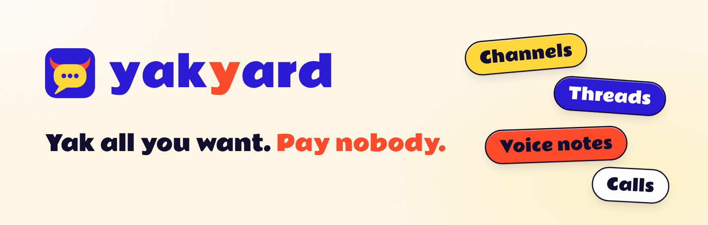
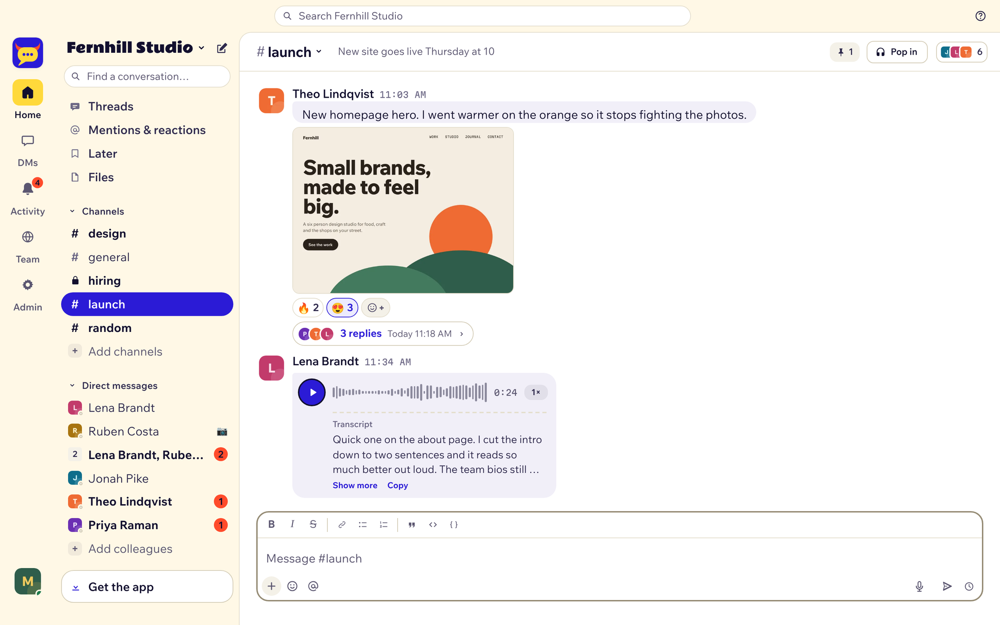
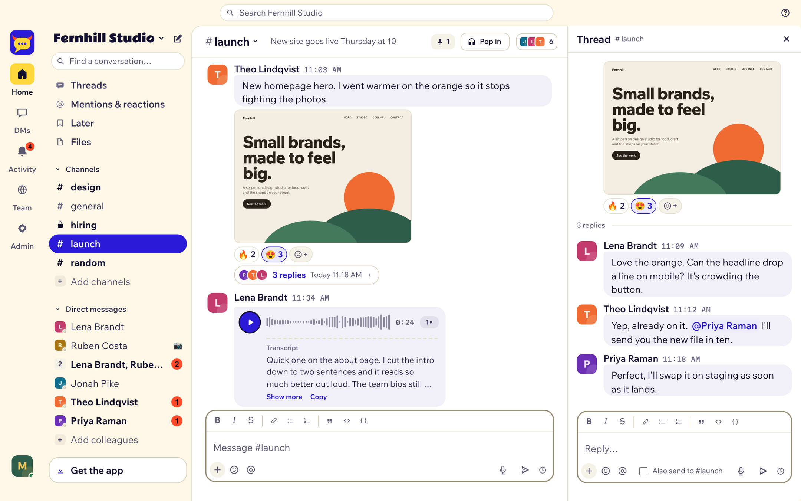
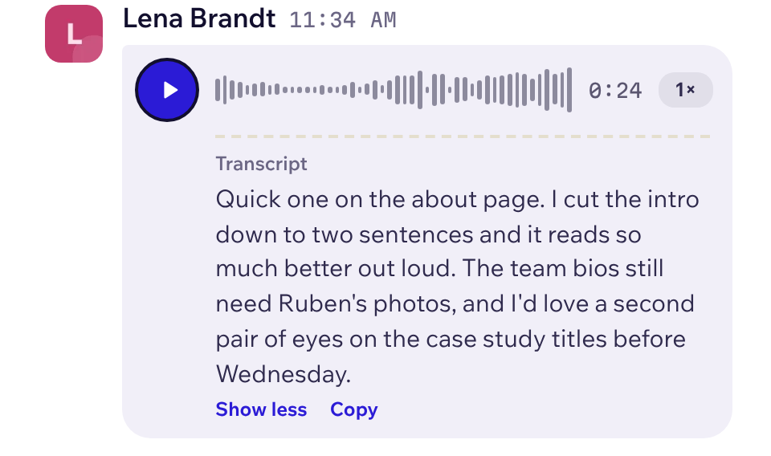
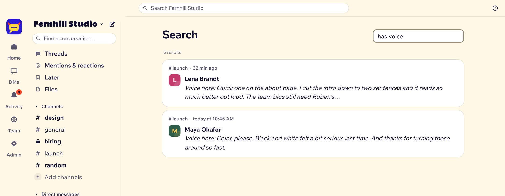
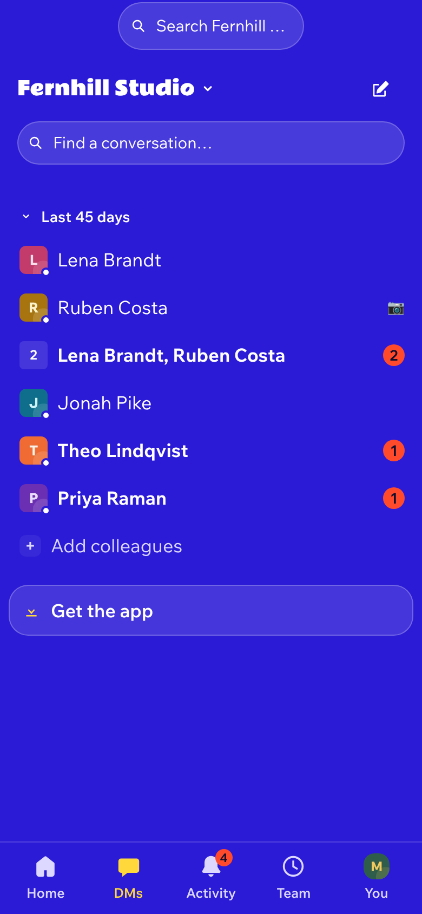
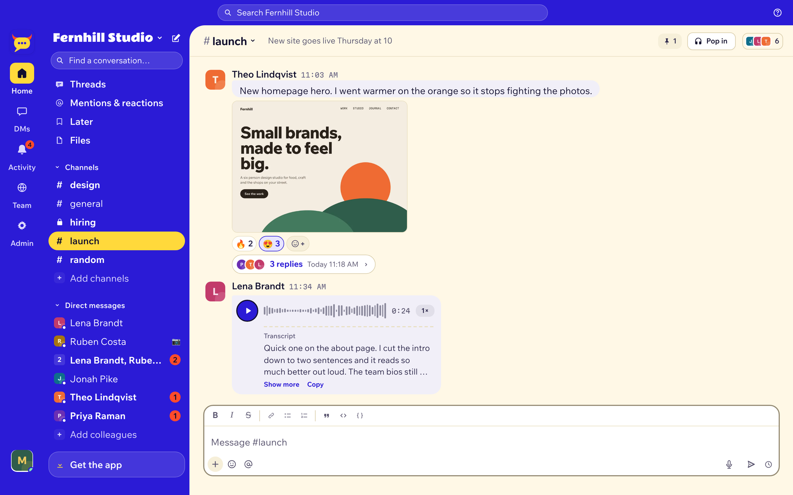
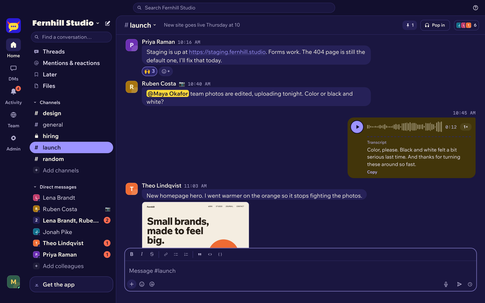
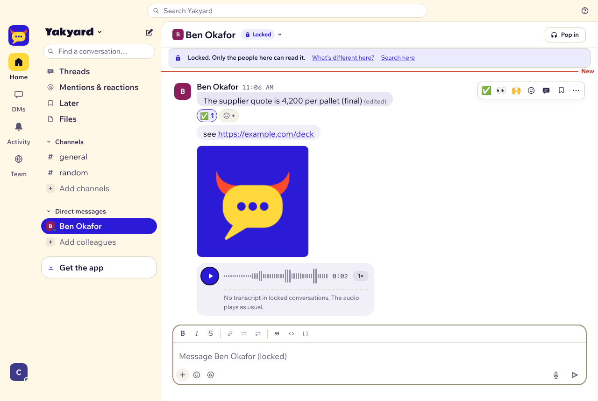
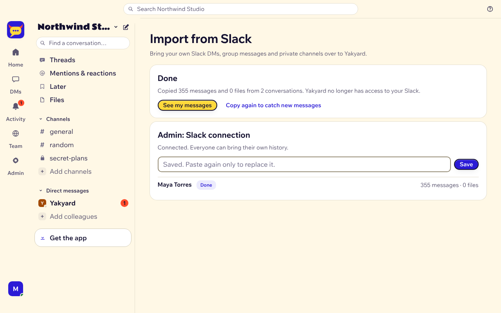

<p align="center">
  <picture>
    <source media="(prefers-color-scheme: dark)" srcset="docs/brand/readme-banner-dark.png">
    
  </picture>
</p>

<p align="center"><a href="https://yakyard.pages.dev/media/yakyard-demo.mp4"></a><br><sub><a href="https://yakyard.pages.dev/media/yakyard-demo.mp4">Watch the 80-second tour</a></sub></p>

<p align="center"><b>Yakyard</b> is a free Slack alternative you run on your own Cloudflare account.<br>Channels, threads, DMs, calls and voice notes with transcripts. Locked conversations when it's private. No per-seat bill.</p>

<p align="center"><b>New in 2.2:</b> Yakyard runs on your own Linux server too, with Docker and Caddy. <a href="docs/releases/2.2.0.md">What changed</a></p>

<p align="center"><a href="https://yakyard-demo.qvinta.workers.dev"><b>Try the live demo</b></a>. One click, no signup. It resets every night.</p>

<p align="center">
  <a href="https://deploy.workers.cloudflare.com/?url=https://github.com/yakyard/yakyard"></a>
  <br><sub>Rather use your own server? <a href="#run-it-on-your-own-server">Run it with Docker</a>.</sub>
</p>

<p align="center">
  <a href="https://github.com/yakyard/yakyard/actions/workflows/ci.yml"></a>
  <a href="LICENSE"></a>
  <a href="https://scorecard.dev/viewer/?uri=github.com/yakyard/yakyard"></a>
</p>

<p align="center">
  <a href="https://yakyard.pages.dev/"><b>Website</b></a> ·
  <a href="docs/SETUP.md"><b>Set it up in about 30 minutes</b></a> ·
  <a href="docs/GUIDE.md">See how it works</a> ·
  <a href="docs/FAQ.md">FAQ</a> ·
  <a href="docs/COMPARE.md">Compare</a> ·
  <a href="LICENSE">License</a>
</p>

<p align="center"></p>

---

## Why Yakyard

Your team's chat is your team's history: decisions, files, the reason something was built the way it was. Most chat apps rent it back to you. You pay for every person, every month. On a free plan, the old messages go behind a paywall, or go away.

Yakyard is a full team chat that you deploy once to your own Cloudflare account. It fits on Cloudflare's free plan for a team of up to about 50 people, so for most small teams the bill is $0. Nobody else holds your messages, and nobody can raise the price per head.

It started as an internal tool. It's built for and used every day by a real team that left Slack. If your people know Slack, they already know where everything is.

## What you get

**Talk the usual way.** Public and private channels, threads, direct and group messages, @mentions, reactions, pins. A message box with buttons for bold, lists, quotes and code, so nobody types markdown. Files, photos and videos up to 1 GB, with link previews.

<p align="center"></p>

**Talk out loud.** Tap the mic, talk for up to 15 minutes, send. Every voice note gets a written transcript automatically, and the transcripts are searchable. When typing is too slow, click **Pop in** for a call in any channel or DM, with screen share and camera.

<p align="center"></p>

**Find it later.** Search covers messages and voice transcripts, with `from:`, `in:`, `has:`, `before:` and `after:` filters. Activity, Threads, Mentions, Files and Later pages keep the rest in reach.

<p align="center"></p>

**Don't forget it.** Send a message later, set a reminder on any message, or save it for Later. All three live on one page.

**Take it everywhere.** Install Yakyard like an app on iPhone, Android, Mac and Windows (it's a PWA). Push notifications with quiet hours, muted channels and VIPs who still get through.

<p align="center">&nbsp;&nbsp;</p>

**Make it yours.** Three themes: Light, Dark and Yaky, the loud one. Each person picks their own.

<p align="center"></p>

<p align="center"></p>

**Lock what's private.** Tick **Lock it** when you start a DM or private channel. Messages, files and voice notes are then encrypted on each person's device, with vodozemac, the library behind Element's encryption. The server only stores scrambled data. Your admin can't read it, and neither can someone with your Cloudflare account, or us. Locking takes two approvals, and the app tells you plainly what works differently in there (search stays on your device, no transcripts, and if you lose every device and your recovery key, those messages are gone). [How it works](docs/E2EE.md).

**Preview:** the encryption library is audited, Yakyard's own code around it is not yet. We have applied for an independent audit.

<p align="center"></p>

**Bring people in, keep others out.** Invite links, passwords, or Sign in with Google limited to your company domain. Guests (clients, freelancers) only see the channels you give them.

**Leave Slack with your history.** Each person copies their own Slack DMs, group messages and private channels, with files and reactions. Read-only access, removed when the copy is done.

<p align="center"></p>

The full tour, with pictures, is in [How to use Yakyard](docs/GUIDE.md).

## What it costs

| Team | Slack Pro, paid yearly | Yakyard on Cloudflare's free plan |
|---|---|---|
| 10 people | $870 a year | $0 |
| 25 people | $2,175 a year | $0 |
| 50 people | $4,350 a year | $0 |

Slack Pro is $7.25 per person a month paid yearly, $8.75 paid monthly ([source](docs/sources.md#slack)).

Yakyard fits Cloudflare's free plan because every request finishes in under 10 ms of CPU. On a real Cloudflare account, normal requests took 1 to 7 ms. Two things run out first on a busy day:

- **Voice transcripts:** about 214 minutes a day for the whole team. After that, notes still send and play, and their transcripts arrive after midnight UTC.
- **Photo previews:** 5,000 a month. After that, photos show at full size.

Pay Cloudflare **$5 a month** (Workers Paid) when you pass about 50 busy people, more than about 3 hours of voice notes a day, or you keep seeing "free database allowance". You flip it in the Cloudflare dashboard. Yakyard doesn't change. File storage (R2) needs a payment card on file even on the free plan, and the first 10 GB are free.

The per-person math is in [TECHNICAL.md](docs/TECHNICAL.md#free-plan-math).

## Pros and cons

**Good**
- $0 for most teams under about 50 people. No per-seat price, ever: above that, $5 a month for the whole account.
- Your messages and files live in your own Cloudflare account. You back them up, and you can delete all of it.
- Voice notes with transcripts, written automatically and searchable.
- Calls built in: pop in to any channel or DM, with screen share.
- Your Slack DMs, private channels and files come with you.
- Installs on phone and desktop, with push notifications.
- Private channels stay private, even from admins.
- One click to deploy. No server or Docker to look after.
- Backups to a file you keep, with one command or every night by themselves.
- Three themes, including Yaky, the loud one we made for fun.
- Open source under Apache 2.0. Use it, change it, even sell it.
- Optional end-to-end encryption for DMs and private channels you choose to lock (a preview).

**Worth knowing**
- Someone on your team runs it. Updates and backups can run by themselves, or take one command each.
- Built for Cloudflare. It also runs on your own server with Docker, but transcripts still need a free Cloudflare token there.
- No app store app. It's an installable web app, with notifications.
- Only locked conversations are end-to-end encrypted. The rest is readable to whoever controls your Cloudflare account. Locked ones have limits: search only on your device, no transcripts, and a lost recovery key means lost messages.

The fine print (calls, transcript languages, the Slack import, support) is in [Pros and cons](docs/PROS-AND-CONS.md).

## How it compares

| | Price per person a month | Free plan catch | Run it yourself | License |
|---|---|---|---|---|
| **Yakyard** | $0. Above about 50 people, $5 a month for the whole team (Cloudflare) | Cloudflare's daily limits | Yes, on your Cloudflare account with no server, or on your own server with Docker | Apache 2.0 |
| Slack | Pro $7.25 yearly / $8.75 monthly | 90 days of history; older than a year is deleted | No | Closed |
| Microsoft Teams | Essentials $4 (yearly) | Free Teams: 60-minute group calls | No | Closed |
| Google Chat | In Workspace, from $7 yearly / $8.40 flexible | No free business plan | No | Closed |
| Discord | Free; Nitro $9.99 is per person and optional | Discord gets a license to your content | No | Closed |
| Mattermost | Paid plans by quote | Free Entry edition shows 10,000 messages of history | Yes, Linux server + PostgreSQL | MIT (Team Edition) / commercial |
| Rocket.Chat | Commercial plans by quote | Starter: up to 50 people | Yes, your server | MIT (Community) / commercial |
| Zulip | Cloud Standard $6.67 yearly / $8 monthly | Cloud Free: 10,000 messages of search history | Yes, free self-hosted | Apache 2.0 |
| Campfire | Free | No calls listed | Yes, your server | MIT |
| Element (Matrix) | Enterprise per seat, by quote | Community is for non-professional use | Yes, your server | AGPL-3.0 / commercial |

Prices checked on 21 November 2026, links in [sources](docs/sources.md). Some of these beat Yakyard at things that might matter to you. Want a chat with years of self-hosting behind it? Zulip, Mattermost or Campfire. Need end-to-end encryption on every conversation, with an audited client? Element. The app-by-app version is in [COMPARE.md](docs/COMPARE.md).

## Install

1. Make a free [Cloudflare account](https://dash.cloudflare.com/sign-up) and turn on R2 (file storage) in the dashboard.
2. Click **Deploy to Cloudflare** at the top. It copies Yakyard to your GitHub, creates the database, file storage and background jobs, and deploys. When it asks for `SETUP_TOKEN`, type a long random code and keep it.
3. Open the address it gives you, paste the setup code, and create the owner account.
4. Click **Invite people** and send the links to your team.

No GitHub account? Use the terminal instead:

```bash
git clone https://github.com/yakyard/yakyard.git
cd yakyard
npx wrangler login
npm run deploy        # prints your address and a one-time setup code
```

The full walkthrough for people who don't code, with notifications, Google sign-in and Slack import, is [Set up Yakyard, free](docs/SETUP.md). About 30 minutes.

Phone notifications, Slack import, Google sign-in, team clocks and every other setting are in [TECHNICAL.md](docs/TECHNICAL.md): see [Notifications](docs/TECHNICAL.md#notifications), [Optional features](docs/TECHNICAL.md#optional-features) and [All settings](docs/TECHNICAL.md#all-settings). Updates and backups are one command each, or can run by themselves: [Updating](docs/TECHNICAL.md#updating), [Backups](docs/TECHNICAL.md#backups), [By themselves](docs/SETUP.md#updates-and-backups-by-themselves).

## Run it on your own server

Yakyard also runs on any Linux server with Docker, with HTTPS from Caddy and all your data in one volume:

```bash
git clone https://github.com/yakyard/yakyard.git
cd yakyard
cp .env.example .env      # set DOMAIN and SETUP_TOKEN
docker compose up -d
```

Then open `https://your-domain/setup`. Backups and updates are one command each. Voice notes work, but transcripts need a free Cloudflare token, and it's one server with no automatic scaling. Step by step, with the limits: [Run Yakyard on your own server](docs/DOCKER.md). About 15 minutes.

## FAQ

**Is it really free?** The software is free. It runs on Cloudflare's free plan for up to about 50 people. Above that, Cloudflare charges $5 a month for the whole account, not per person.

**Can I use it at work?** Yes. Any company can run it for its own team, for free. You can also change it, host it for clients or sell it, under the Apache 2.0 terms.

**Who can read our messages?** People in your workspace, and whoever has access to your Cloudflare account. Nobody at Yakyard can see them.

**Is it end-to-end encrypted?** Yes, optionally, for DMs and private channels you lock. Only the people in a locked conversation can read it, not the admin and not the server. The trade-offs: search there only covers your device, notifications don't show the message, no transcripts or link previews, and losing every device and your recovery key loses those messages. **Preview:** the encryption library is audited, Yakyard's own code around it is not yet. We have applied for an independent audit. [Details](docs/E2EE.md).

**Is there a phone app?** Yakyard installs from the browser on iPhone and Android, with its own icon and notifications. There's no App Store or Play Store app.

**What happens to our Slack history?** Each person copies their own Slack DMs, group messages and private channels, with files. Public channel history stays in Slack.

**What if Yakyard stops being developed?** Your copy keeps running on your account. You have the code, the database and a backup command. Nothing phones home.

**Who do I call when it breaks?** Nobody sells support. There's the [setup guide](docs/SETUP.md#when-something-fails), [GitHub issues](https://github.com/yakyard/yakyard/issues) and the people who use it.

**Is it open source?** Yes. Yakyard is under the Apache License 2.0, an OSI-approved open source license. Use it, change it, host it or sell it. Keep the copyright and license notices, and say what you changed.

More answers in the [full FAQ](docs/FAQ.md).

## Who runs Yakyard

QVINTA Ltd, a Hong Kong company, makes and maintains Yakyard. It started as the in-house chat of a design and wholesale team that left Slack in 2026, and that team still uses it every day. The public history starts in November 2026 because the code was cleaned up from that private app before it went public.

Report problems in [GitHub issues](https://github.com/yakyard/yakyard/issues). Report security holes privately, as [SECURITY.md](SECURITY.md) explains.

## License

Yakyard is open source under the [Apache License 2.0](LICENSE). Copyright 2026 QVINTA Ltd. In plain words:

- **You can** use it, for yourself or for a business of any size. Read the code, change it, run it, host it for other people, build on it and sell it. No fee, no permission to ask.
- **Keep the credit.** When you share Yakyard or something built from it, include the [LICENSE](LICENSE) and [NOTICE](NOTICE) files and mark the files you changed.
- **No warranty.** It comes as is, and the license doesn't give you rights to the Yakyard name or logo.

The 1.0.0 and 2.0.0 releases came out under PolyForm Shield 1.0.0. The code on `main` and every release after 2.0.0 are under Apache 2.0.

Bundled fonts and libraries keep their own licenses: see [THIRD-PARTY.md](THIRD-PARTY.md).

## Credits

- Locked conversations: vodozemac (Apache-2.0), Matrix.org's Olm and Megolm, compiled to WebAssembly.
- Voice transcripts: OpenAI Whisper (MIT), running on Cloudflare Workers AI.
- Emoji picker: emoji-mart (MIT).
- Link previews: adapted from tldraw's cloudflare-workers-unfurl (MIT).
- Fonts: Rammetto One, Wix Madefor Text, Martian Mono (SIL Open Font License).
- Call ideas from OpenSlaq (MIT). No code copied.

## More

- [Why Yakyard](docs/WHY-YAKYARD.md) · [Pros and cons](docs/PROS-AND-CONS.md) · [Compare](docs/COMPARE.md) · [FAQ](docs/FAQ.md)
- [Setup](docs/SETUP.md) · [How to use it](docs/GUIDE.md) · [Technical notes](docs/TECHNICAL.md) · [Locked conversations](docs/E2EE.md) · [Changelog](CHANGELOG.md)
- [Contributing](CONTRIBUTING.md) · [Security](SECURITY.md) · [Support](SUPPORT.md) · [Press kit](docs/PRESS-KIT.md)

Yakyard is an independent project. It isn't affiliated with or endorsed by Slack, Salesforce, Cloudflare or any other company named here. Their names are used only to describe and compare.

<sub>Free forever. Made by QVINTA Ltd.</sub>
