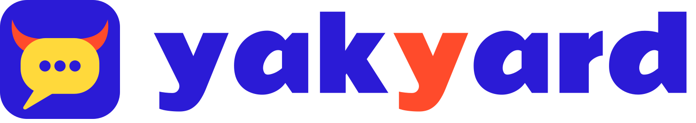
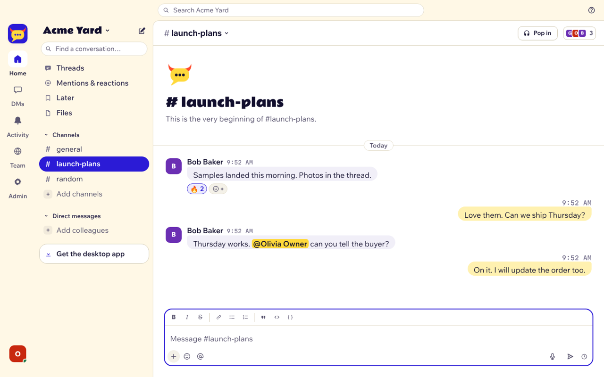

<p align="center"></p>

<p align="center"><b>Yak all you want. Pay nobody.</b></p>

<p align="center">Your own team chat. Channels, threads, calls and voice notes with transcripts.<br>Runs on your Cloudflare account, so nobody bills you per seat and nobody else holds your messages.</p>

<p align="center"></p>

---

## Why

Team chat gets expensive fast, and your company history ends up on someone else's servers. Yakyard is a full team chat you deploy once to your own Cloudflare account. If your team knows Slack, they know Yakyard. It works on phones and computers, and it can bring your Slack history with it.

## What's inside

**Talking**
- Channels (public and private), threads, direct and group messages
- Rich message box: bold, italic, lists, quotes, code, links. No markdown typing needed
- Emoji picker with search and skin tones. Reactions, with "who reacted" cards
- Files, photos and videos up to 1 GB, with link previews
- Edit, delete, pin, save for later, reminders, scheduled send

**Voice notes with transcripts**
- Tap the mic, talk, send. Live waveform while recording, up to 15 minutes
- Player with seek and 1x / 1.5x / 2x speed
- Every note is transcribed automatically (Whisper on Cloudflare Workers AI). Transcripts are searchable and show in phone notifications
- Set the language and a list of names it should spell right (people, brands, product words)

**Calls**
- "Pop-in" audio calls in any channel or DM, with screen share and camera
- Mute yourself or others, pick mic and speaker, clear connected / not connected status per person
- TURN relay support, so calls work on strict office and hotel networks

**Phones and computers**
- Installs like an app on iPhone, Android, Mac and Windows (PWA)
- Push notifications with do-not-disturb hours, muted channels and VIPs
- Unread badge on the app icon. Phone layout with tabs and swipe back
- Presence (active / away) and status with emoji
- Team clocks (off by default): when the admin turns them on, each person can choose to share their city and local time, optionally with the weather there. See "Team clocks and privacy" below

**Finding things**
- Full-text search across messages and voice transcripts, with `from:` `in:` `has:` `before:` `after:` filters
- Activity, Threads, Mentions, Files and Later pages

**Running it**
- Invite links and passwords, or Sign in with Google (optionally limited to your company domain)
- Admin page: people, roles, guests, who can create channels. Private channels stay private: admins can only change who is in a private channel they are in themselves
- Slack import: each person imports their own Slack DMs, group messages and private channels (read-only Slack access, revoked when done). People are matched by Slack account and email, and DMs from two people's imports end up in one conversation
- New-version pop-up so everyone updates at once
- Three looks: light, dark and Yaky (bold color). Each person picks theirs

## What you need

- A Cloudflare account.
- Node.js 22.5 or newer on your computer, only to deploy. Works on macOS, Linux and Windows.

Yakyard uses Workers, Durable Objects, D1 (database), R2 (files), Workers AI (transcripts) and the Images binding (photo previews).

### Free plan or Paid plan

Small teams fit in Cloudflare's free allowances for storage and requests, with two things to know:

- **Sign-in needs more CPU than the Free plan gives.** The Workers Free plan allows 10 ms of CPU time per request ([limits](https://developers.cloudflare.com/workers/platform/limits/)). Yakyard hashes passwords with PBKDF2 (100,000 rounds of SHA-256), which takes about 20 ms. On Free, setup, sign-in and joining can fail with error 1102. We did not lower the hashing to fit, because that would make stolen password hashes much easier to crack. Use Workers Paid ($5 a month) if people sign in with passwords. Google sign-in does not hash passwords.
- **Free allowances run out quietly.** Workers AI Free covers about 200 minutes of voice transcripts a day; after that, transcripts wait until the next day. Cloudflare Images Free covers 5,000 photo previews a month; after that, photos show at full size. Check [Cloudflare's pricing](https://developers.cloudflare.com/workers/platform/pricing/) for current numbers.

## Try it on your computer first

```bash
git clone https://github.com/yakyard/yakyard.git
cd yakyard
npm ci
cp wrangler.toml.example wrangler.toml     # for local testing you can leave the CHANGE values as they are
echo "SETUP_TOKEN=$(openssl rand -hex 24)" > .dev.vars
npm run db:init:local                      # creates the tables in a local database
npm run dev                                # open the address it prints, usually http://localhost:8787
```

The first visit shows **Set up Yakyard**. The setup code is the `SETUP_TOKEN` in `.dev.vars`. Use an email from `OWNER_EMAILS` in `wrangler.toml`.

Notes for local testing:
- `.dev.vars` holds secrets for `wrangler dev`, one `NAME=value` per line. It is in `.gitignore`. Put `VAPID_PRIVATE`, `TOKEN_KEY` and others here when you test those features.
- Workers AI always runs on Cloudflare, even locally, so voice transcripts need `npx wrangler login` and count against your account.
- If every page shows `no such table: users`, run `npm run db:init:local` again.

## Deploy

Do these in order.

```bash
npx wrangler login

# 1. Settings file
cp wrangler.toml.example wrangler.toml

# 2. Database and file storage
npx wrangler d1 create yakyard            # copy the database_id it prints into wrangler.toml
npx wrangler r2 bucket create yakyard-files
```

If Wrangler offers to add the database to your config for you, answer No and paste the `database_id` yourself.

**3. Fill in `wrangler.toml`.** Every line marked CHANGE:
- `WORKSPACE_NAME`: your team's name, shown on the sign-in page.
- `OWNER_EMAILS`: your email. Owners can do everything.
- `APP_URL`: the address people will use. A new Worker lives at `https://yakyard.<your-subdomain>.workers.dev`. Find your subdomain in the Cloudflare dashboard under **Workers & Pages**, on the right under **Subdomain**. Or deploy once, copy the address it prints, set `APP_URL` and deploy again.

```bash
# 4. Go live
npm run deploy
```

`npm run deploy` creates the tables, deploys, and on the first run makes a setup code and prints it once. Keep it until you have set up Yakyard.

Open the address it prints. The first visit shows **Set up Yakyard**: enter the setup code, then create the owner account with an email you listed in `OWNER_EMAILS`. The setup code makes sure nobody else can claim your new workspace before you do. It only works once. Then invite your team from the menu (**Invite people**). Invites make a link: you send it yourself, by email, chat or text.

To keep R2 tidy, add a lifecycle rule to the `yakyard-files` bucket in the Cloudflare dashboard (R2, the bucket, Settings, Object lifecycle rules) that aborts incomplete multipart uploads after 1 day.

### Notifications (recommended)

```bash
npm run vapid                             # prints VAPID_PUBLIC, VAPID_SUBJECT and a private key
# put VAPID_PUBLIC and VAPID_SUBJECT in wrangler.toml under [vars], then:
npx wrangler secret put VAPID_PRIVATE     # paste the private key line
npm run deploy
```

`VAPID_SUBJECT` is an email address push services can reach you at, written as `mailto:you@example.com`. Until these are set, the owner sees "Phone notifications are off" in the first-run checklist.

On iPhone, people add Yakyard to the Home Screen first (Share, Add to Home Screen), then turn notifications on inside the app.

### Optional

| Feature | What to set |
|---|---|
| Sign in with Google | Create an OAuth client in Google Cloud (redirect `https://YOUR-URL/auth/callback`). Set `GOOGLE_CLIENT_ID`, `GOOGLE_ENABLED = "1"`, secret `GOOGLE_CLIENT_SECRET`. `ALLOWED_DOMAINS` lets anyone with your company email in. |
| Calls on strict networks | Create a TURN key in Cloudflare Realtime. Secrets `TURN_KEY_ID` and `TURN_KEY_TOKEN`. |
| Slack import | Create a Slack app with user scopes `channels:read groups:history groups:read im:history im:read mpim:history mpim:read users:read users:read.email files:read reactions:read`, redirect `https://YOUR-URL/slack/callback`. Set `SLACK_CLIENT_ID` and `SLACK_TEAM_ID` (your Slack workspace id, starts with `T`), secrets `SLACK_CLIENT_SECRET` and `TOKEN_KEY`. `TOKEN_KEY` must be exactly 32 random bytes written as base64: make one with `openssl rand -base64 32` and paste the whole line into `npx wrangler secret put TOKEN_KEY`. Instead of the `SLACK_CLIENT_SECRET` secret, the owner can paste the Client Secret on the import page; it is stored encrypted with `TOKEN_KEY`. Guests can't import. |
| Team clocks | `TEAM_LOCATION = "1"`. See "Team clocks and privacy". |
| Weather on team clocks | `WEATHER = "1"` as well. See "Team clocks and privacy". |
| Better transcripts | `VOICE_LANGUAGE` (e.g. `en`, `fr`, `es`) and `VOICE_HINT` with names and words to spell right. |
| Your own domain | Add a custom domain to the `yakyard` Worker in the Cloudflare dashboard and update `APP_URL`. |

### Team clocks and privacy

Team clocks are off unless you set `TEAM_LOCATION = "1"`. Even then, nothing is collected until a person turns on **Share my city and local time** in Status and notifications. Then Yakyard stores the city, region, country and time zone that Cloudflare reports for their connection, and shows them to teammates (never to guests). Turning it off deletes the stored city right away.

With `WEATHER = "1"`, coordinates rounded to about 10 km are also stored for people who share, and sent to [Open-Meteo](https://open-meteo.com/) to get the weather. Open-Meteo's free API is for non-commercial use only. A company running Yakyard is likely commercial use: check [their terms](https://open-meteo.com/en/terms) and get an API plan if needed, or leave `WEATHER` off.

Each person's time zone is always saved from their own browser (not their location), so do-not-disturb hours work. It is only shown to others if they share.

### All settings

| Name | Where | Needed | What it does |
|---|---|---|---|
| `WORKSPACE_NAME` | `[vars]` | yes | Team name on the sign-in page. Default "Yakyard". |
| `OWNER_EMAILS` | `[vars]` | yes | Comma-separated owner emails. |
| `APP_URL` | `[vars]` | yes | Public address. Used in reminder links and as the push contact if `VAPID_SUBJECT` is empty. |
| `SETUP_TOKEN` | secret | first run | Setup code for the first visit, 24+ characters. `npm run deploy` makes one if it is missing. |
| `VAPID_PUBLIC`, `VAPID_SUBJECT` | `[vars]` | for notifications | From `npm run vapid`. |
| `VAPID_PRIVATE` | secret | for notifications | From `npm run vapid`. |
| `ALLOWED_DOMAINS` | `[vars]` | no | Email domains that may sign in with Google without an invite. |
| `GOOGLE_CLIENT_ID`, `GOOGLE_ENABLED` | `[vars]` | no | Google sign-in. |
| `GOOGLE_CLIENT_SECRET` | secret | with Google | Google sign-in. |
| `SLACK_CLIENT_ID`, `SLACK_TEAM_ID` | `[vars]` | no | Slack import. |
| `SLACK_CLIENT_SECRET`, `TOKEN_KEY` | secret | with Slack import | `TOKEN_KEY` is base64 of 32 random bytes. |
| `TURN_KEY_ID`, `TURN_KEY_TOKEN` | secret | no | Calls behind strict networks. |
| `VOICE_LANGUAGE`, `VOICE_HINT` | `[vars]` | no | Transcript language and spelling hints. |
| `TEAM_LOCATION`, `WEATHER` | `[vars]` | no | Team clocks and weather. Both default to off. |
| `DEV_LOGIN` | `[vars]` | no | Local testing only: `/auth/dev?email=...` signs in on localhost. Keep `"0"` in production. |
| `SLACK_API` | `[vars]` | no | Tests only: point the Slack import at a mock server. |

## Updating

```bash
git pull
npm run deploy    # also creates any new tables
```

Deploying adds missing tables and indexes. It does not add new columns to tables you already have, so read the release notes: a release that changes a table says what to run. Also compare `wrangler.toml.example` with your `wrangler.toml` for new settings, since your own file is never overwritten.

Open apps show "New version of Yakyard" and update in one tap.

## Tests

```bash
npm test
```

Runs the unit tests, then the security checks against a local server if one is running (`npx wrangler dev --local --port 8797` on a fresh `npm run db:init:local`). The security checks need Python 3 with `requests` and `playwright`.

## How it's built

No framework and no build step. Plain JavaScript in `public/app.js`, a Cloudflare Worker in `src/`.

| Part | File |
|---|---|
| API, sign-in, files | `src/worker.js` |
| Live updates, presence, calls signaling | `Hub` Durable Object in `src/worker.js` |
| Push, status, search, reminders, scheduled send | `src/features.js` |
| Voice notes and transcripts | `src/voice.js` |
| Slack import | `src/slackimport.js` |
| Link previews | `src/unfurl.js` |
| Database tables | `schema.sql` |

## License

Yakyard is free to use, change and run for your own team or company, under the [PolyForm Shield License 1.0.0](LICENSE.md).

What you can't do is use it to make a product that competes with Yakyard: selling it, or offering it as a hosted chat service to others. If you want to do that, ask QVINTA Ltd for a commercial license by opening an issue.

Bundled fonts and libraries keep their own licenses, see [THIRD-PARTY.md](THIRD-PARTY.md).

Yakyard is an independent project. It is not affiliated with or endorsed by Slack or Salesforce. "Slack" is used only to describe the import feature.
