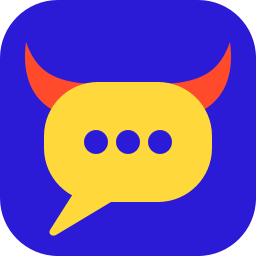

<!-- nav -->

<a href="../README.md">&nbsp; <b>Yakyard</b></a> &nbsp;/&nbsp; <a href="WHY-YAKYARD.md">Why</a> · <a href="PROS-AND-CONS.md">Pros and cons</a> · <b>Compare</b> · <a href="FAQ.md">FAQ</a> · <a href="SETUP.md">Setup</a> · <a href="GUIDE.md">Guide</a> · <a href="TECHNICAL.md">Technical</a> · <a href="PRESS-KIT.md">Press kit</a>

<!-- /nav -->

# Yakyard compared

How Yakyard stacks up against the chat apps teams actually choose between. Every price and limit here was checked on the vendor's own page on **21 November 2026**, and every one is linked in [sources](sources.md). Prices are US dollars per person a month unless it says otherwise. They change, so check before you decide.

We say where others are better. Several are.

## At a glance

| | Cheapest paid price | Free option | Run it yourself | Needs a server | License | Voice notes with transcripts | End-to-end encryption |
|---|---|---|---|---|---|---|---|
| **Yakyard** | $0 for the software; Cloudflare $5 a month per account above about 50 people | Yes, about 50 people on Cloudflare's free plan | Yes, on your Cloudflare account, or your own server with Docker | No (optional with Docker) | Apache 2.0 (open source) | Yes | Optional: locked DMs and private channels (Olm/Megolm via vodozemac). Not in normal channels. |
| Slack | Pro $7.25 yearly / $8.75 monthly | 90 days of history, 10 apps, 1:1 huddles | No | n/a | Closed | Not compared | Not compared |
| Microsoft Teams | Essentials $4 (yearly) | Free Teams: 60-minute group calls, 100 people, 5 GB each | No | n/a | Closed | Not compared | Not compared |
| Google Chat | Workspace Business Starter $7 yearly / $8.40 flexible | No free business plan | No | n/a | Closed | Not compared | Not compared |
| Discord | Free for servers; Nitro $2.99 or $9.99 is a personal extra | Yes | No | n/a | Closed | Not compared | Not compared |
| Mattermost | Paid plans by quote | Entry: 10,000 messages of history; Team Edition: free | Yes | Linux + PostgreSQL | MIT (Team Edition), commercial (Enterprise) | Not compared | Not compared |
| Rocket.Chat | Commercial plans by quote | Starter: up to 50 people; Community: 100 at once | Yes | Yes | MIT (Community), commercial | Not compared | Not compared |
| Zulip | Cloud Standard $6.67 yearly / $8 monthly | Cloud Free: 10,000 messages searchable, 5 GB files; self-hosted free | Yes | Yes | Apache 2.0 | Not compared | Not compared |
| Campfire | Free | Yes | Yes | Yes | MIT | Not listed | Not compared |
| Element (Matrix) | Enterprise per seat, by quote | Community, for non-professional use | Yes | Yes | AGPL-3.0, commercial | Not compared | Yes, the main pitch ("end-to-end encrypted messaging and calls") |

"Not compared" means we didn't check that feature for that app, so we make no claim.

## Yakyard vs Slack

**Slack is better at:** integrations (over 2,600 apps in its directory), shared channels with up to 250 outside organizations on Pro (Slack Connect), group huddles with video and screen share, a vendor you can pay for support, and years of polish.

**Yakyard is better at:** price and history. Slack Pro costs $7.25 per person a month paid yearly or $8.75 monthly. Business+ is $15 or $18. The free plan keeps 90 days of history visible and, since 26 August 2024, deletes messages and files older than a year for good. Yakyard costs $0 on Cloudflare's free plan for about 50 people and keeps history until you delete it. It also has voice notes with written transcripts.

**What it costs a year:**

| People | Slack Pro yearly | Slack Pro monthly | Yakyard |
|---|---|---|---|
| 10 | $870 | $1,050 | $0 |
| 25 | $2,175 | $2,625 | $0 |
| 50 | $4,350 | $5,250 | $0, or $60 if you need Workers Paid |

**Moving over:** Yakyard looks and works like Slack on purpose. Each person can copy their own Slack DMs, group messages and private channels, with files and reactions. Public channel history doesn't come over.

**Pick Slack if** you rely on integrations, work with other companies in shared channels, or need compliance paperwork. **Pick Yakyard if** you're a small team paying for seats to have conversations.

## Yakyard vs Microsoft Teams

**Teams is better at:** meetings (Essentials allows 300 participants and 30-hour meetings), phone calling add-ons, and companies already paying for Microsoft 365.

**Yakyard is better at:** chat that doesn't cost per person. Teams Essentials is $4 per person a month paid yearly. Microsoft 365 Business Basic is $7. Free Teams limits group calls to 60 minutes. Yakyard feels like Slack, not like Office, and has no per-seat price at all.

**Pick Teams if** your company already lives in Microsoft 365. **Pick Yakyard if** you want team chat without buying an office suite.

## Yakyard vs Google Chat

**Google Chat is better at:** fitting into Gmail, Drive, Docs and Meet. If you already pay for Google Workspace, Chat comes with every plan.

**Yakyard is better at:** being a team chat first. Workspace Business Starter is $7 per person a month yearly or $8.40 flexible, Standard $14 or $16.80. If you don't need the rest of Workspace, that's a lot for chat. Yakyard works fine next to Google: people can sign in with their Google account, limited to your domain.

**Pick Google Chat if** you already pay for Workspace and like it. **Pick Yakyard if** you want Slack-style chat with threads, voice notes and Later, and nothing else to buy.

## Yakyard vs Discord

**Discord is better at:** communities and big public servers. It's free for servers. Nitro ($2.99 or $9.99 a month) is a personal extra.

**Yakyard is better at:** being a company's own chat. Discord's terms give Discord a license to your content and don't let you run the software yourself. You must be 13 or older to use it, and the product is built around communities. Yakyard runs on your account, under your control, with guests, reminders, scheduled send and a Slack-style layout.

**Pick Discord if** you run a community. **Pick Yakyard if** you run a team.

## Yakyard vs Mattermost

**Mattermost is better at:** big and security-heavy deployments. Paid plans add things like air-gapped installs. It runs on your own hardware.

**Yakyard is better at:** small teams that don't want to run a server. Mattermost Team Edition runs as a Linux binary with PostgreSQL that you host and maintain. The free Entry edition is suited to teams under 50 and shows only 10,000 channel messages of history. Paid plans are priced by quote. Yakyard needs no server, shows all your history, and costs $0 for about 50 people.

**Pick Mattermost if** you want years of self-hosting track record on your own hardware, or an enterprise vendor. **Pick Yakyard if** you'd rather not be a sysadmin.

## Yakyard vs Rocket.Chat

**Rocket.Chat is better at:** government and defense deployments (on-premises, sovereign cloud, air-gapped). It runs on infrastructure you control.

**Yakyard is better at:** simplicity. Rocket.Chat's free Starter plan is for up to 50 people, self-hosted. Community allows 100 people connected at once. Commercial prices aren't published. Both free options need you to run a server. Yakyard doesn't.

**Pick Rocket.Chat if** you need your own or isolated infrastructure. **Pick Yakyard if** you want team chat with nothing to host.

## Yakyard vs Zulip

**Zulip is better at:** topic-based conversations, native apps for macOS, Windows, Linux, iOS and Android, and a free self-hosted edition.

**Yakyard is better at:** feeling like Slack, and costing nothing without a server. Zulip Cloud Standard is $6.67 per person a month yearly or $8 monthly. Cloud Free keeps 10,000 messages searchable and 5 GB of files. Self-hosted Zulip is free, but you run the server. Yakyard adds voice notes with transcripts.

**Pick Zulip if** you want topic-based threading or native apps. **Pick Yakyard if** your team wants a Slack-like layout and no server.

## Yakyard vs Campfire (ONCE)

Campfire, from 37signals, is the closest in spirit: free, simple, self-hosted.

**Campfire is better at:** keeping things very simple, on any server you choose. Like Yakyard, it's open source (MIT).

**Yakyard is better at:** not needing a server (Campfire runs on one you provide), and features. Campfire's page lists rooms, mentions, DMs, search, a PWA with push and bots. It doesn't list calls, threads in the Slack sense, voice notes, transcripts, scheduled send or a Slack import. Yakyard has all of those.

**Pick Campfire if** you have a server and like a simpler room-based chat. **Pick Yakyard if** you want a fuller Slack replacement with nothing to host.

## Yakyard vs Element (Matrix)

**Element is better at:** encryption everywhere (Yakyard only encrypts the DMs and private channels you lock, and its own code around the encryption library isn't audited yet), encrypted calls, Matrix federation between organizations, and sovereign and air-gapped deployments. Both use the same encryption library, vodozemac. If every conversation must be encrypted, or you need an audited client, choose Element.

**Yakyard is better at:** easy setup and zero cost for a business. Element's free Community offering is for "non-professional deployments and evaluations", and the Synapse server is AGPL or commercial. Enterprise is priced per seat by quote, and you run the servers. Yakyard is free for any business, needs no server, and its Apache 2.0 license doesn't make you publish your changes.

**Pick Element if** you need encryption on everything, encrypted calls or federation. **Pick Yakyard if** you want a simple, free team chat where the sensitive DMs and private channels can be locked.

## The short version

- Want **no bill and no server**, and you're under about 50 people? **Yakyard.**
- Need **end-to-end encryption for a few sensitive conversations**? Yakyard's locked conversations. **For everything, with an audited client?** Element.
- Want **open source on your own server**? Yakyard runs there with [Docker](DOCKER.md), transcripts aside. For a chat with years of self-hosting behind it: Zulip, Campfire, Mattermost Team Edition, Rocket.Chat Community or Element.
- Need **integrations, native apps, a vendor and compliance**? Slack, Teams or Google Chat, and the per-seat bill that comes with them.
- Running a **community**? Discord.

---

Spot a price that's changed? [Open an issue](https://github.com/yakyard/yakyard/issues/new/choose) and we'll update it. Back to the [README](../README.md).
