<!-- nav -->

&nbsp; <a href="../README.md"><b>Yakyard</b></a> &nbsp;/&nbsp; <a href="WHY-YAKYARD.md">Why</a> · <a href="PROS-AND-CONS.md">Pros and cons</a> · <a href="COMPARE.md">Compare</a> · <a href="FAQ.md">FAQ</a> · <a href="SETUP.md">Setup</a> · <b>Guide</b> · <a href="TECHNICAL.md">Technical</a> · <a href="PRESS-KIT.md">Press kit</a>

<!-- /nav -->

# Using Yakyard

Yakyard is your team's chat. If you have used Slack, you already know most of it. This page covers the rest in about five minutes.

The **?** button at the top right of the app has the short version of this page.

- [Sign in](#sign-in)
- [Put it on your phone and computer](#put-it-on-your-phone-and-computer)
- [Channels and direct messages](#channels-and-direct-messages)
- [Threads](#threads)
- [Mentions and reactions](#mentions-and-reactions)
- [Voice notes and transcripts](#voice-notes-and-transcripts)
- [Pop in: calls](#pop-in-calls)
- [Locked conversations](#locked-conversations)
- [Search](#search)
- [Send later, reminders and Later](#send-later-reminders-and-later)
- [Notifications](#notifications)
- [Themes and how it looks](#themes-and-how-it-looks)
- [Your profile and status](#your-profile-and-status)
- [Keyboard shortcuts](#keyboard-shortcuts)
- [Guests](#guests)

## Sign in

Someone on your team sends you a link. Open it, type your name, pick a password of at least 10 characters, and you're in.

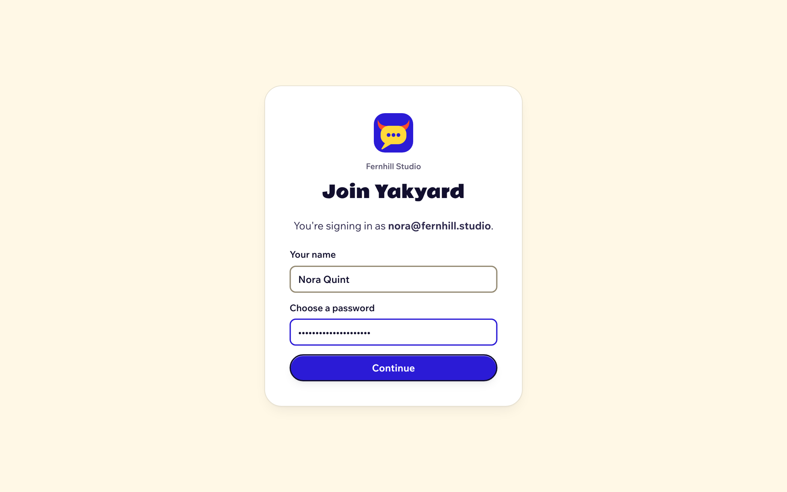

Next time, open your team's Yakyard address and sign in with your email and password. If your team turned on Google, you can click **Continue with Google** instead.

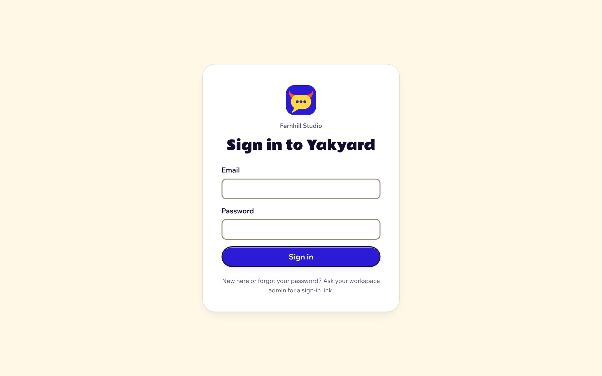

Forgot your password? Ask your admin for a new link. To change it yourself, open **Status and notifications** and use **Password**. Changing it signs you out on your other devices.

## Put it on your phone and computer

Yakyard works in any browser. Installed, it gets its own icon, opens like a normal app, and can send notifications.

- **iPhone or iPad:** open your Yakyard address in Safari, tap Share, then **Add to Home Screen**.
- **Android:** in Chrome, tap the three dots at the top right, then **Install app**.
- **Computer:** in Chrome or Edge, click the install icon at the right end of the address bar. In Safari on a Mac, use **File**, then **Add to Dock**.

The **Get the app** button at the bottom of the sidebar shows the steps for your device.

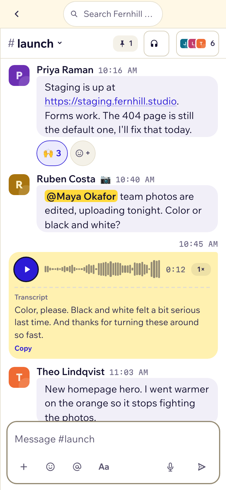

## Channels and direct messages

- **Channels** are for topics and projects. Everyone in the team can join public channels. Private channels (with a lock) are for the people in them.
- **Direct messages** are for one person or a small group, up to 9 people.
- Click **Add channels** to browse or create a channel. Click **Add colleagues** or the pencil at the top to start a direct message.
- Press Ctrl + K (⌘ + K on a Mac) to jump to any conversation by typing its name.
- Write in the box at the bottom. Enter sends. Shift + Enter starts a new line. You can change that in **Status and notifications**, under **Enter key**.
- The buttons above the box make text bold, italic, a list, a quote or code. No codes to remember.
- Drop files or photos on the box to attach them, up to 1 GB each.
- To edit or delete your message, hover it (or long-press on a phone) and open the three dots. Up arrow in an empty box edits your last one.

## Threads

Keep side conversations out of the way. Hover a message and click **Reply** (on a phone, long-press it). Replies open on the right. Tick **Also send to #channel** if everyone should see your reply.

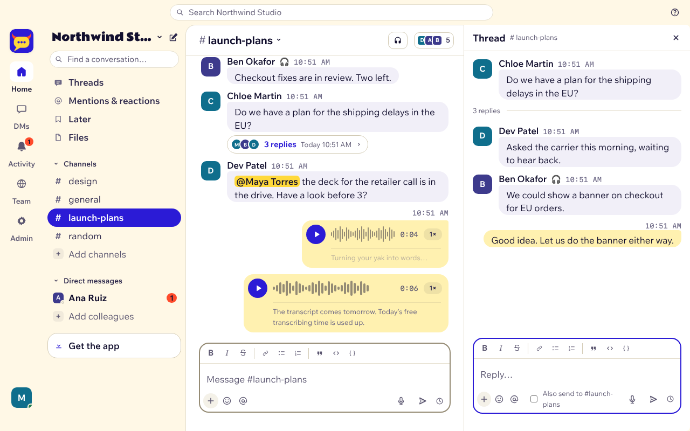

**Threads** in the sidebar lists every thread you started or replied to.

## Mentions and reactions

Type **@** and a name to get someone's attention. They get a notification. **@here** or **@channel** reaches everyone in the conversation, so use it when it matters.

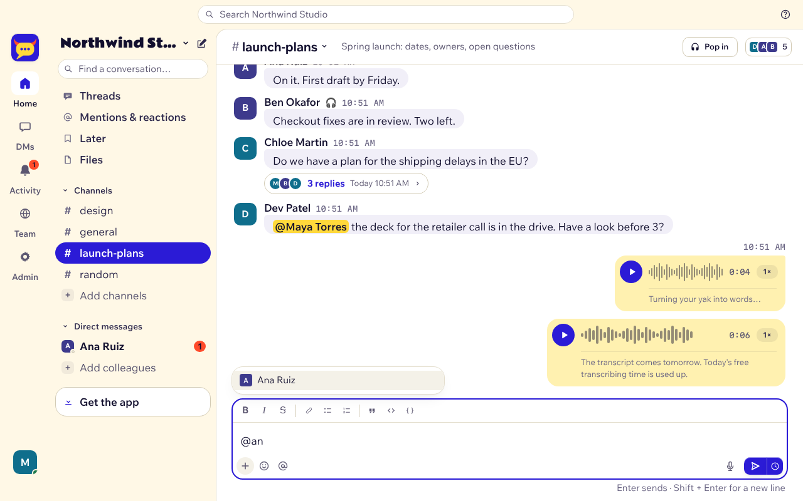

To react, hover a message and pick an emoji. Hover a reaction to see who reacted. **Mentions & reactions** in the sidebar shows everything aimed at you.

## Voice notes and transcripts

Tap the mic in the message box, talk, then send. Up to 15 minutes.

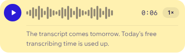

- Yakyard writes down what you said. The transcript shows under the note and is searchable.
- Play at 1x, 1.5x or 2x. Click the waveform to jump.
- Phone notifications for a voice note show the first words.
- Your team has about 3.5 hours of free transcripts a day. When they run out, the note still sends and plays, and it says **The transcript comes tomorrow**. It arrives by itself after midnight UTC.

## Pop in: calls

Click **Pop in** at the top of any channel or direct message to start a voice call there. Others see it and can pop in too. Turn on video or share your screen from the call bar. Ctrl + Shift + H pops you in or out.

## Locked conversations

Some talks should stay between the people in them: pay, hiring, a client's numbers. Lock that DM or private channel. Its messages, photos, files and voice notes are then scrambled on your device before they leave it. Only the people in it can read them, not your admin and not the server.

Your workspace owner turns this on first (**Admin**, **Locked conversations**).

**Lock a DM.** Click **+ New message**, pick the people, tick **Lock it**, then **Go**.

**Lock a channel.** **Add channels**, **Create a new channel**, tick **Lock it**. A locked channel is always private.

**Step 1: read what changes.** A list shows what works and what doesn't. Tick **I understand what changes here**, then **Continue**.

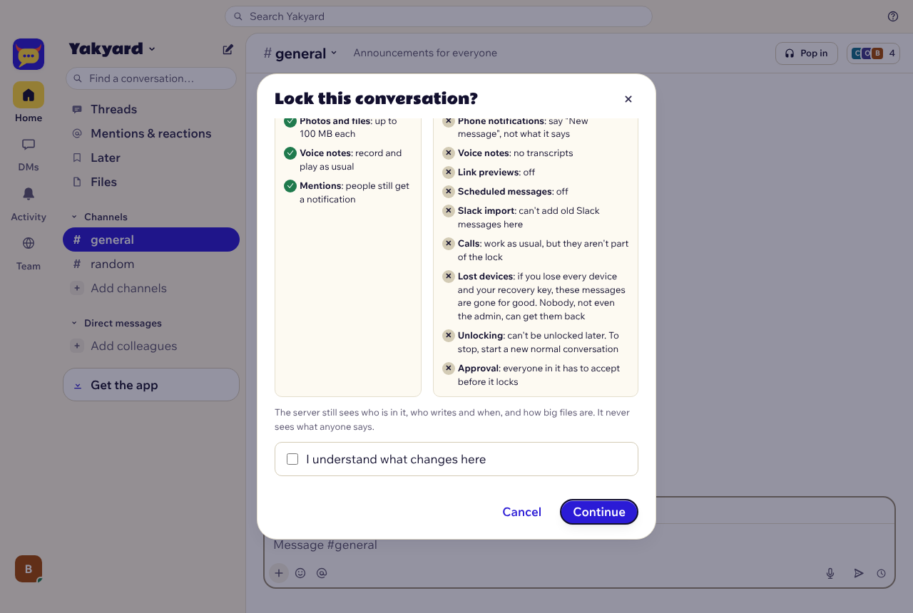

**Step 2: confirm.** Type the channel name, or `lock` for a DM.

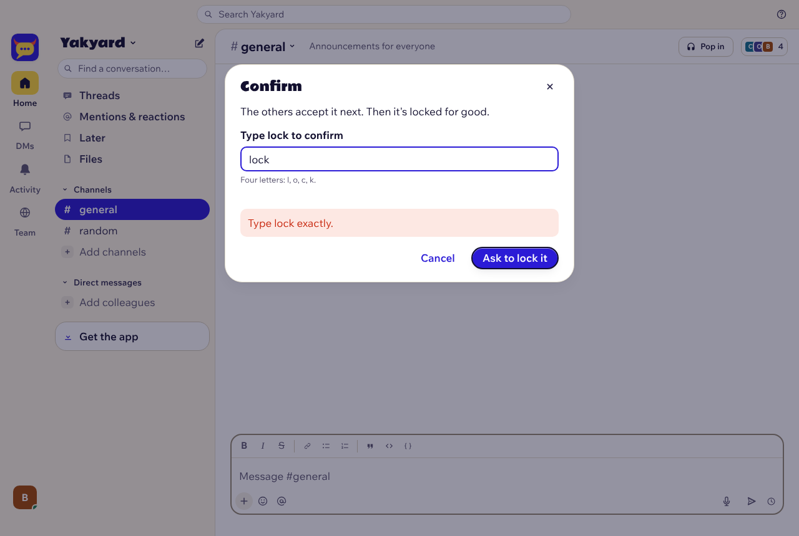

**The first time: your recovery key.** You get a key of 53 letters and numbers. It opens your locked conversations on a new phone or computer. Copy it into a password manager or download it, then type its last 4 characters to show you saved it.

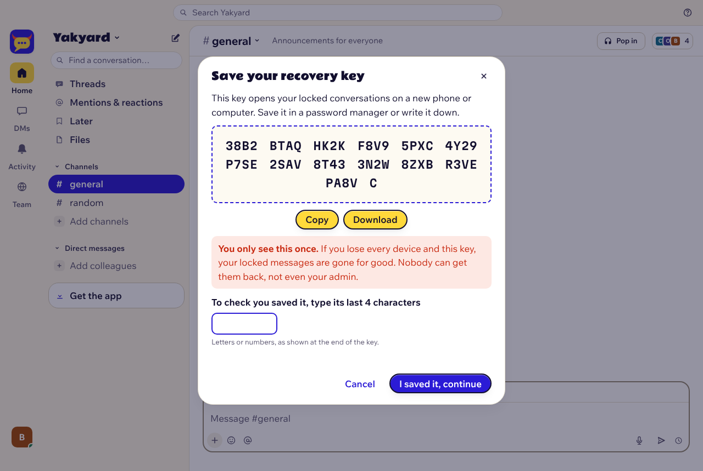

> If you lose every device **and** your recovery key, your locked messages are gone for good. Nobody can get them back, not even your admin.

**Then a second person says yes.** Nobody can post until then, and the conversation says what it's waiting for.
- A DM locks when everyone in it accepts. They see **Review and accept** at the bottom, and go through the same two steps.
- A channel locks when an admin or the owner approves it in **Admin**. If you're an admin yourself, another admin approves it (unless you're the only one).

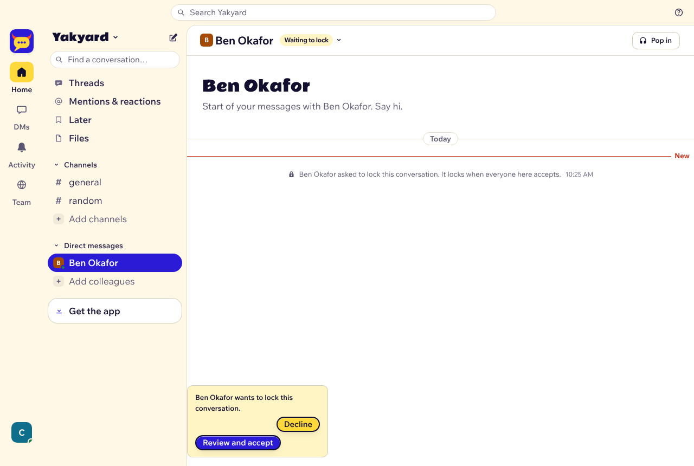

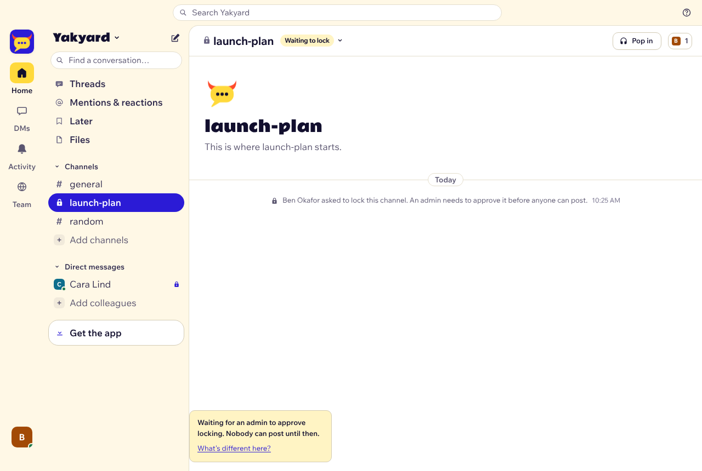

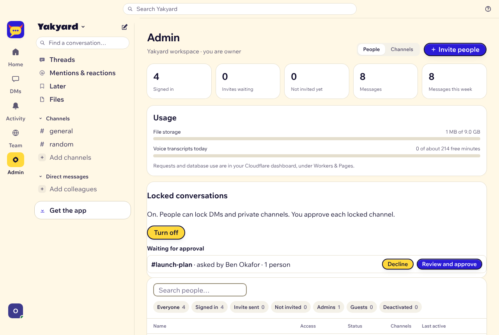

Every request, acceptance and approval shows as a line in the conversation, with who and when.

**In a locked conversation** you see a **Locked** tag next to its name and a banner at the top. **What's different here?** opens the list again.

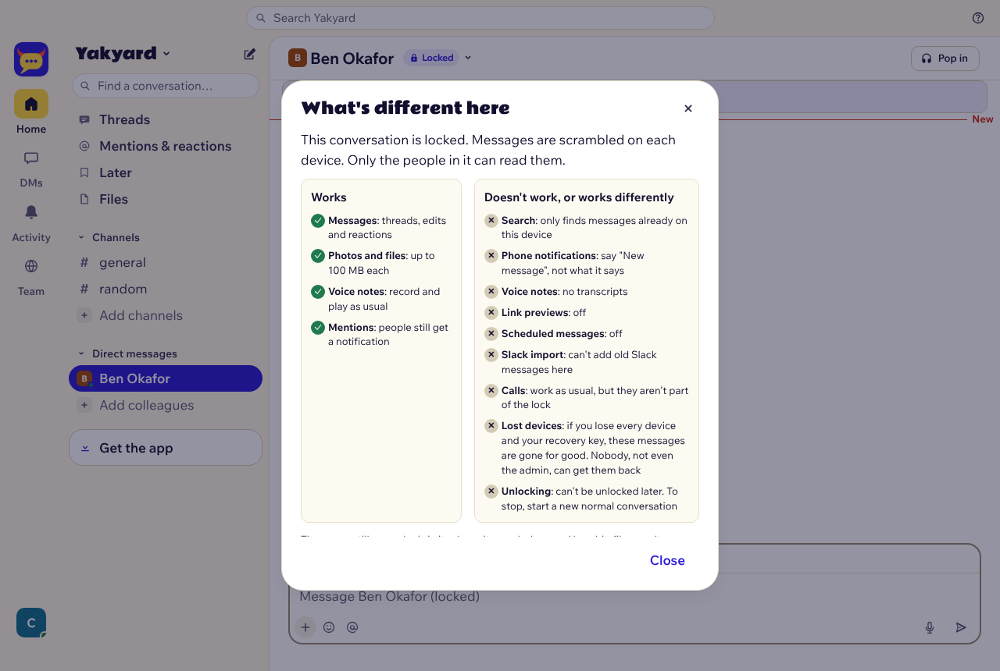

What works differently:
- **Search:** the search bar at the top doesn't look inside locked conversations. Use **Search here** in the banner. It searches messages already on this device.
- **Phone notifications:** say "New message in a locked conversation", not what it says.
- **Voice notes:** play as usual, but there's no transcript.
- **Link previews and scheduled messages:** off.
- **Slack import:** can't add old Slack messages to a locked conversation.
- **Calls:** work as usual, but they aren't part of the lock.
- **Locked for good:** a conversation can't be unlocked. To stop, start a new normal one.
- **What the server still sees:** who is in it, who writes and when, and how big files are. Never what anyone says.

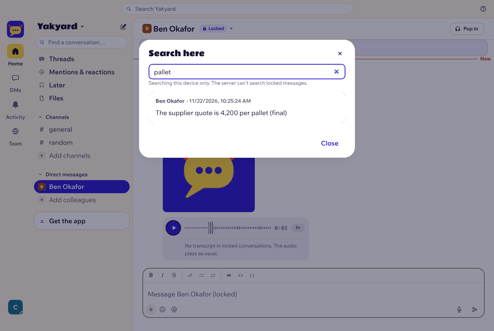

**A new phone or computer.** Open a locked conversation and click **Set up this device to read it**. Type your recovery key, or click **Approve from another device instead**: your other device asks **Is this you?** and shows a code. If both codes match, approve it.

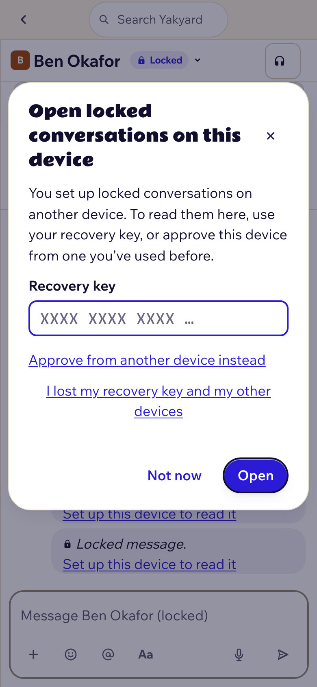

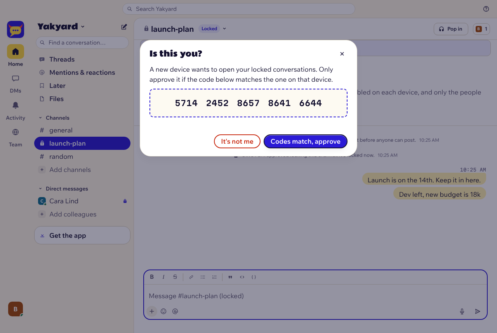

**Signing out** removes the keys from that device. To read locked conversations there again, you need your recovery key or another device.

**Your devices:** the **?** button, then **Your devices and recovery key**, lists the devices that can read your locked conversations. Remove any you no longer use.

How it works underneath, and what it does and doesn't protect against: [Locked conversations, technical](E2EE.md).

## Search

Click the search bar at the top, or press Ctrl + F. Type words, or add filters:

| Type | To find |
|---|---|
| `from:@ana` | messages from Ana |
| `in:#launch-plans` | messages in one channel |
| `has:voice` | voice notes (their transcripts are searched too) |
| `has:file`, `has:image`, `has:link` | messages with files, photos or links |
| `has:pin`, `has:reaction` | pinned messages, messages with reactions |
| `before:2026-12-01`, `after:2026-11-01`, `on:2026-11-21` | messages by date |

Mix them: `banner from:@ben in:#launch-plans`.

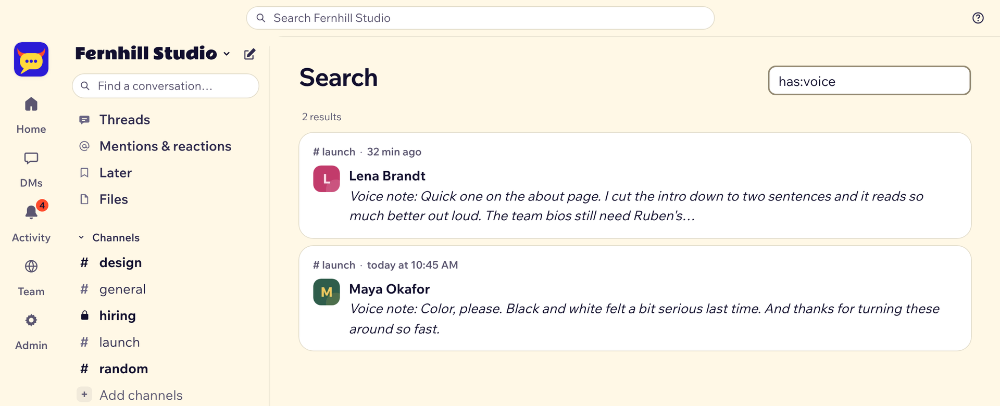

**Files** in the sidebar lists every file shared with you, with filters for photos, documents and more.

## Send later, reminders and Later

- **Send later:** write your message, then click the clock next to Send. Pick a time.
- **Remind me:** hover a message, open the three dots, **Remind me about this**. The Yakyard bot sends you a direct message at that time.
- **Save for later:** hover a message and click the bookmark.

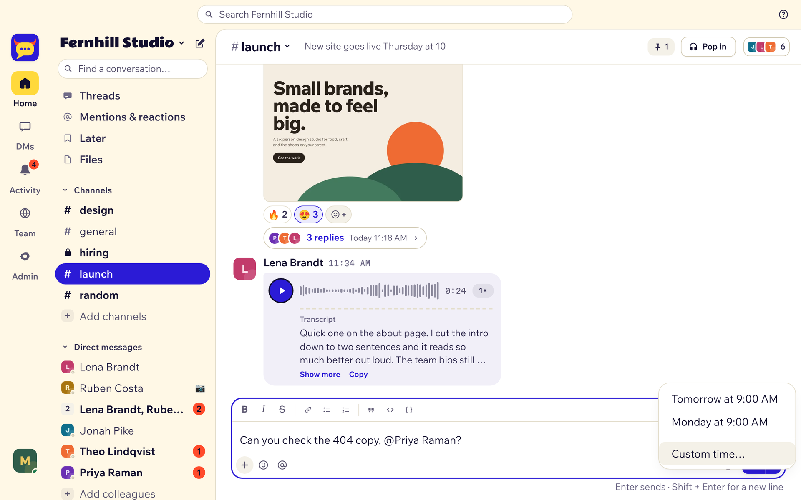

**Later** in the sidebar keeps all three in one place, on three tabs. You can send a scheduled message now, change its time, or delete it.

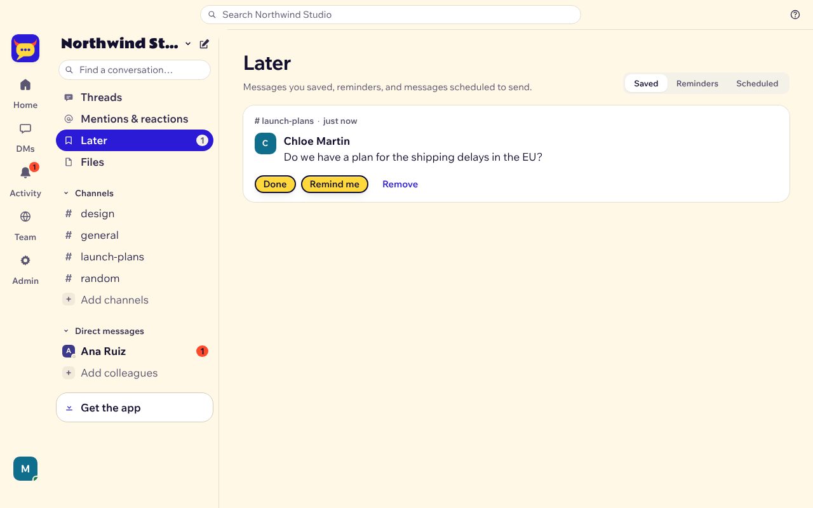

## Notifications

Open **Status and notifications** from your picture at the bottom left.

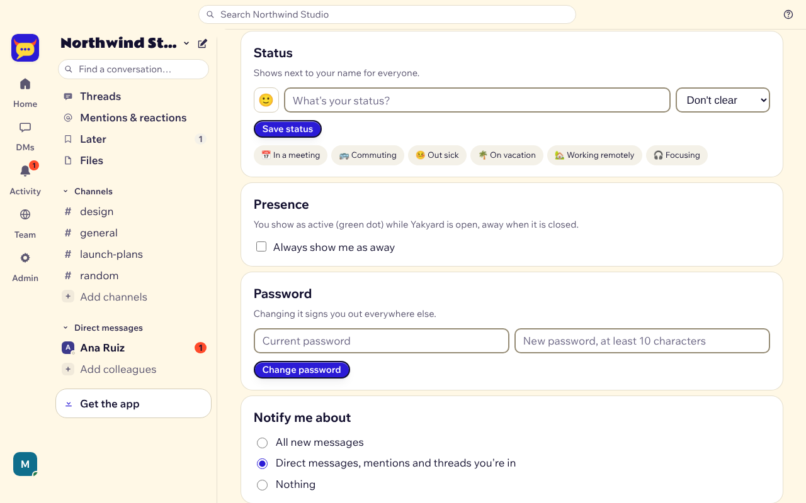

- **Notify me about:** all new messages, only direct messages, mentions and your threads (the default), or nothing.
- **This device:** turn notifications on for the phone or computer you are on. Each device asks once.
- **Do not disturb:** quiet hours every day, or **Pause notifications** for a while. People see a moon next to your name.
- **VIPs:** direct messages from these people still reach you while you're paused.
- While Yakyard is open on your screen, your phone stays quiet.

On iPhone, add Yakyard to your Home Screen first. Notifications only work from the installed app.

## Themes and how it looks

In **Status and notifications**:

- **Theme:** Light, Dark, or Yaky (bold color). **Match my device** follows your phone or computer.
- **Look:** bubbles like text messages, or a classic list.
- **Text size:** bigger or smaller, for this device.

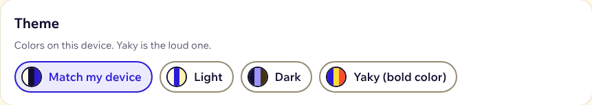

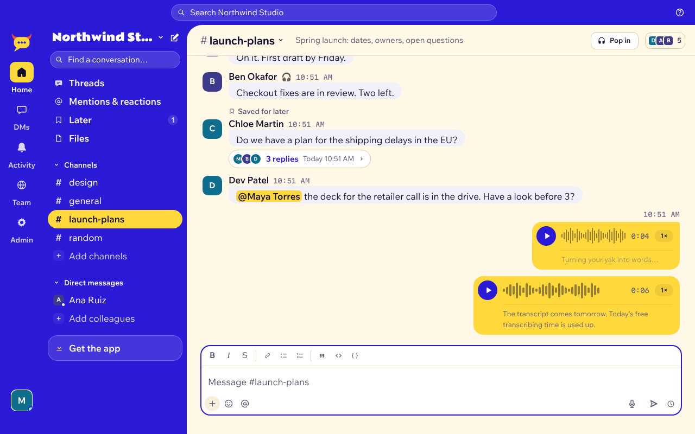

## Your profile and status

Click your picture at the bottom left.

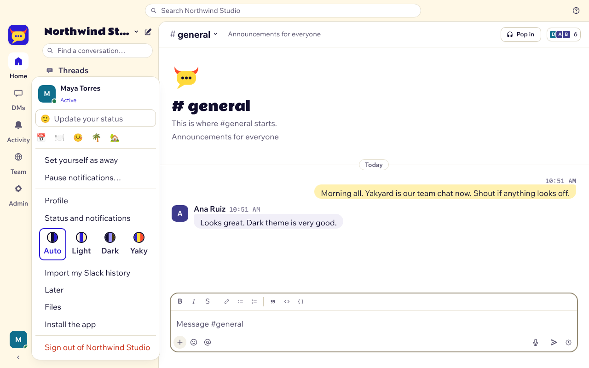

- **Status:** a short line and an emoji next to your name, like "In a meeting". Pick one of the presets or write your own, and when it should clear.
- **Profile:** your name, title and photo.
- **Set yourself as away** hides your green dot until you turn it back.
- The four circles switch the theme for this device.

## Keyboard shortcuts

| Keys | Does |
|---|---|
| Ctrl/⌘ + K | Jump to a conversation |
| Ctrl/⌘ + F | Search messages |
| Ctrl/⌘ + Shift + H | Pop in or out of a call |
| Alt + ↑ or ↓ | Previous or next channel |
| Alt + Shift + ↑ or ↓ | Previous or next unread |
| ↑ in an empty box | Edit your last message |
| Shift + Enter | New line |
| Esc | Close a panel, or mark the conversation read |

The **?** button lists them too.

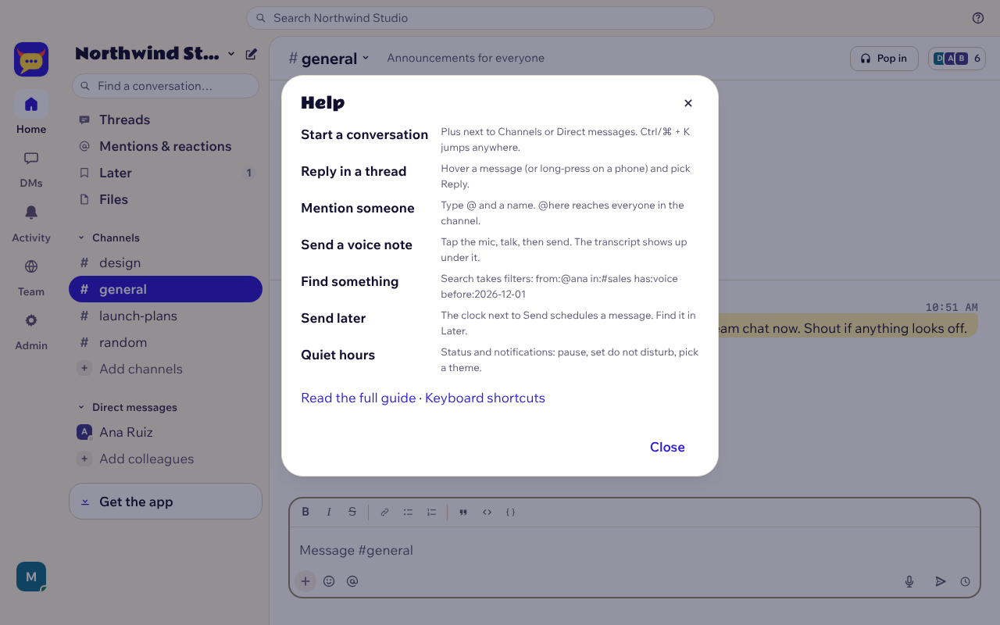

## Guests

Guests are people from outside your team, like clients or freelancers. They:

- only see the channels they were invited to, and the people in them,
- can send direct messages to those people,
- can't create channels, add people, pin messages or change topics.

Admins invite guests from **Invite people** by ticking **Guest (partner)**.

---

Running Yakyard for your team? See [Set up Yakyard, free](SETUP.md).
