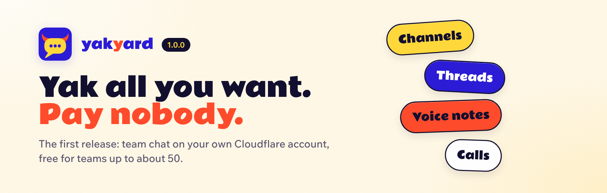
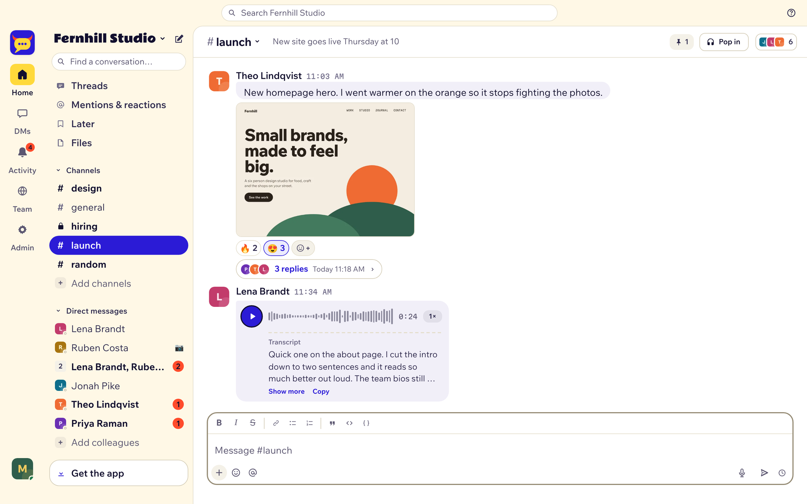
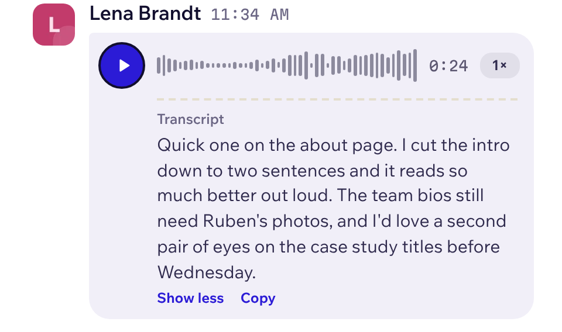
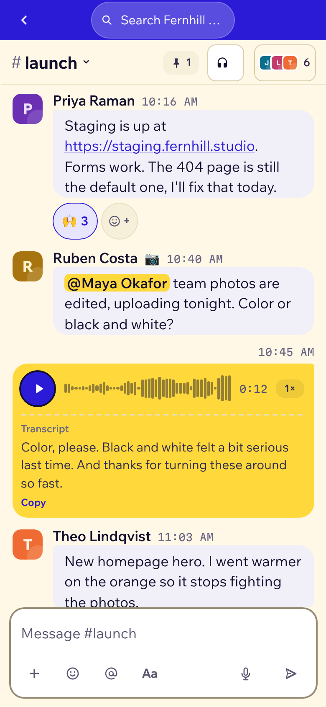

<h3 align="center">Team chat you run on your own Cloudflare account.</h3>

Free for teams of up to about 50 people. No per-seat bill, no server to look after.

<a href="https://github.com/yakyard/yakyard/blob/main/docs/SETUP.md"><b>Set it up in about 30 minutes</b></a>&nbsp;&nbsp;&nbsp;&nbsp;<a href="https://yakyard.pages.dev">Visit the website</a>

## Talk the way you already do

Public and private channels, threads, DMs and group messages, mentions, reactions and pins. The message box has buttons for bold, lists, quotes and code. Send files, photos and videos up to 1 GB, with link previews.

## Talk out loud

Record voice notes up to 15 minutes with a live waveform. Each one gets a written transcript (Whisper on Cloudflare Workers AI), and you can search the transcripts. Pop in starts a call in any channel or DM, with camera and screen share.

 

## Find it later

Search with `from:`, `in:`, `has:`, `before:` and `after:`. Activity, Threads, Mentions, Files and Later each get their own page. Schedule messages, set reminders and save things for Later.

## Take it everywhere

Yakyard installs like an app on iPhone, Android, Mac and Windows, with push notifications, quiet hours, muted channels and VIPs. Pick Light, Dark or Yaky, the loud one.

## Bring people in

Invite links, passwords stretched in the browser, Sign in with Google for your domain, and guests who only see the channels you give them.

## Leave Slack with your history

Each person copies their own Slack DMs, group messages and private channels, with files and reactions.

## Run it without a server

Deploy with one command or the Deploy to Cloudflare button. Updates, backups and restores are one command each. Every request fits in Cloudflare's free 10 ms of CPU, and each background job gets its own.

## Worth knowing

- Cloudflare only. There's no App Store app (it's an installable web app) and no support contract.
- Messages are readable to whoever controls your Cloudflare account. Locked, end-to-end encrypted conversations came later, in [2.0.0](https://github.com/yakyard/yakyard/releases/tag/v2.0.0).
- Calls suit small groups. Slack's public channel history stays in Slack.
- Free and source-available under PolyForm Shield 1.0.0: any business can use it, and nobody can resell it.

## Get it

Click Deploy to Cloudflare, or run `npm run deploy`. The setup guide walks you through it in about 30 minutes: [docs/SETUP.md](https://github.com/yakyard/yakyard/blob/main/docs/SETUP.md).

<b>Yak all you want. Pay nobody.</b>

