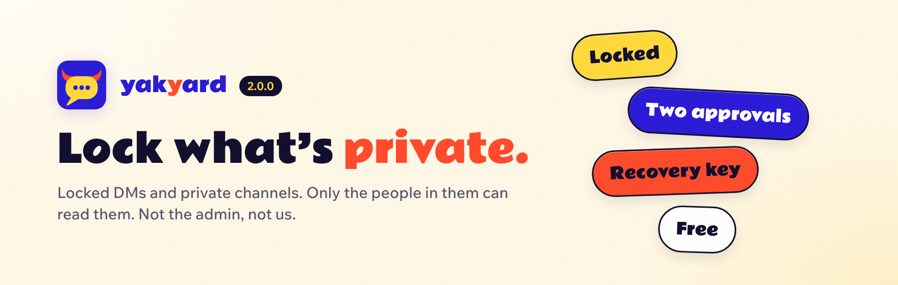
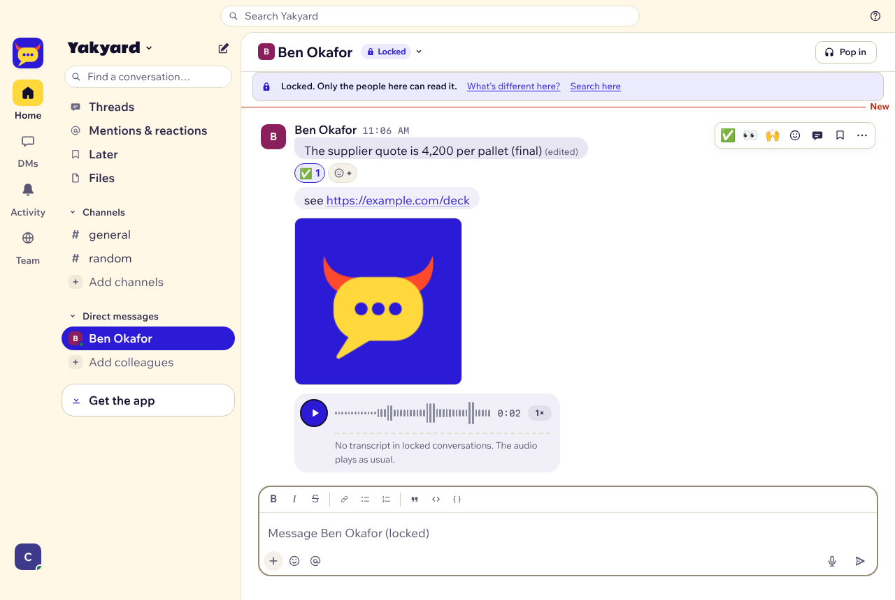
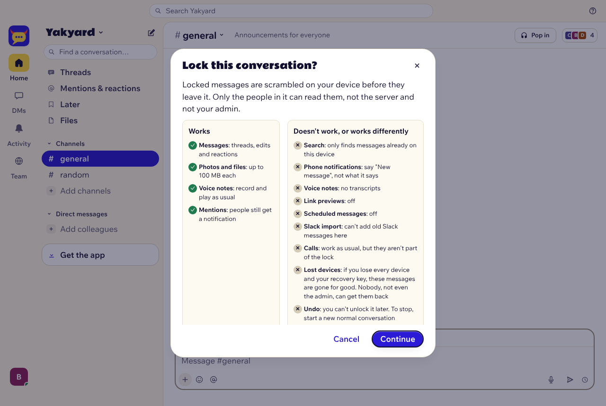
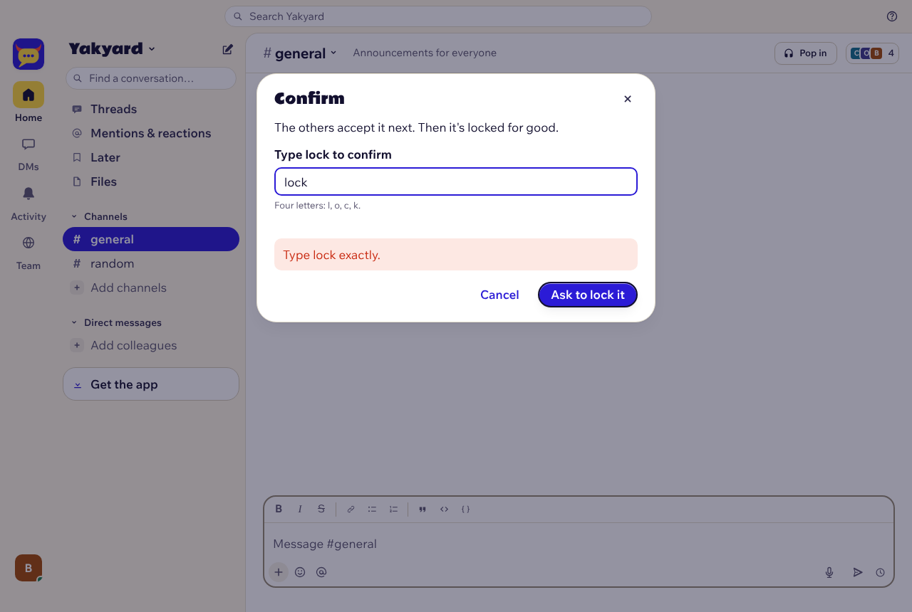
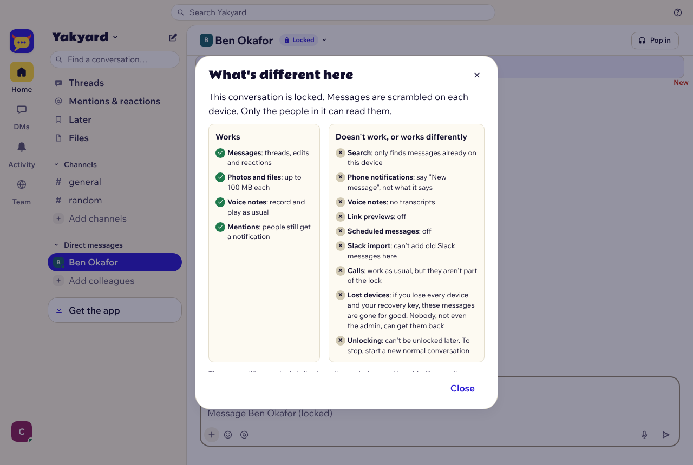

<p align="center"></p>

<h3 align="center">Lock a DM or private channel, and only the people in it can read it.</h3>
<p align="center">Not your admin, not whoever runs your Cloudflare account, and not us.</p>
<p align="center"><a href="https://yakyard.pages.dev/docs/locked"><b>See how locking works</b></a>&nbsp;&nbsp;&nbsp;&nbsp;<a href="#update">Update to 2.0.0</a></p>

## Some talks belong to the people in them

Pay, hiring, a client's numbers. Until now, anyone with access to your Cloudflare account could read every message. Yakyard 2 lets you lock those conversations. Tick "Lock it" when you start a DM or a private channel, and messages, edits, reactions, files and voice notes are scrambled on your device before they leave it.

<p align="center"></p>

## Locking takes two approvals

Locking changes how a conversation works, so it never happens in one click. You read a plain list of what works and what doesn't, and tick "I understand". You type the channel name, or `lock` for a DM. Then a second person agrees: an admin for a channel, everyone in it for a DM. Each step shows up in the conversation.

<p align="center"> </p>

The owner decides whether anyone can lock at all. It's off by default, and turning it on in Admin takes the same two steps.

## Your recovery key

The first time you lock, Yakyard gives you a recovery key with Copy and Download buttons, then checks you saved it. On a new phone, type the key, or approve the phone from a device you already use after you both compare a 20-digit code.

## The app tells you what works differently

A banner at the top of a locked conversation links to "What's different here?". "Search here" looks through the messages on your own device. Voice notes say why they have no transcript. Link previews are off, and the message box says so. Phone notifications only say "New message in a locked conversation". The Slack import skips locked conversations and tells you why.

When you remove someone from a locked channel, the messages after that use new keys they can't open.

<p align="center"></p>

## Before you lock

- If you lose every device and your recovery key, your locked messages are gone for good. Nobody can bring them back, your admin included.
- The server still sees who is in a locked conversation, who writes and when, and how big the files are. It never sees what anyone writes.
- A locked conversation stays locked. Calls work as usual, but the lock doesn't cover them.
- Outside experts audited the encryption library underneath. Yakyard's own code around it hasn't had an outside audit yet, and we've applied for one.

## Under the hood

For the people who check these things:

- Olm and Megolm from vodozemac 0.11.2, the library behind Element's encryption. Apache-2.0, audited by Least Authority in 2022.
- It runs as WebAssembly in your browser: 131 KB gzipped, loaded only when you open a locked conversation. So Yakyard still fits Cloudflare's free plan.
- The locking package is Apache-2.0, so anyone can read and reuse it: `packages/yakyard-lock`.
- A web app gets its code from its server. Yakyard shows a security code that changes whenever the locking code does, and `npm run lock:verify` checks a running server against this release's hashes in `docs/E2EE-HASHES.md`.

The full design and threat model are in [docs/E2EE.md](https://github.com/yakyard/yakyard/blob/main/docs/E2EE.md).

## Also in this release

CodeQL, Semgrep, OpenSSF Scorecard and Dependabot now check every change. And Yakyard has a website, built from these docs, with a live demo chat: [yakyard.pages.dev](https://yakyard.pages.dev).

## Update

```bash
npm run backup
npm run update
```

The update adds the new tables by itself. Then, as the owner, open Admin, go to Locked conversations and choose "Turn on".

New to Yakyard? Setup takes about 30 minutes, no coding: [docs/SETUP.md](https://github.com/yakyard/yakyard/blob/main/docs/SETUP.md).

<p align="center"><a href="https://deploy.workers.cloudflare.com/?url=https://github.com/yakyard/yakyard"></a></p>

<p align="center"><b>Yak all you want. Pay nobody.</b></p>
