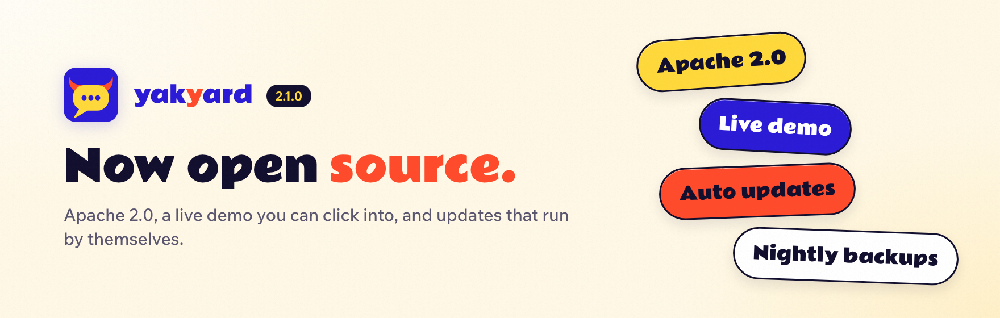
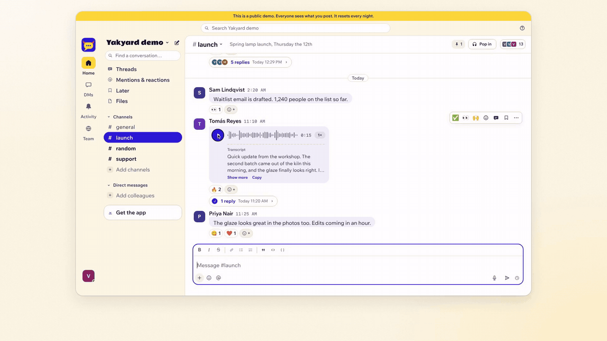
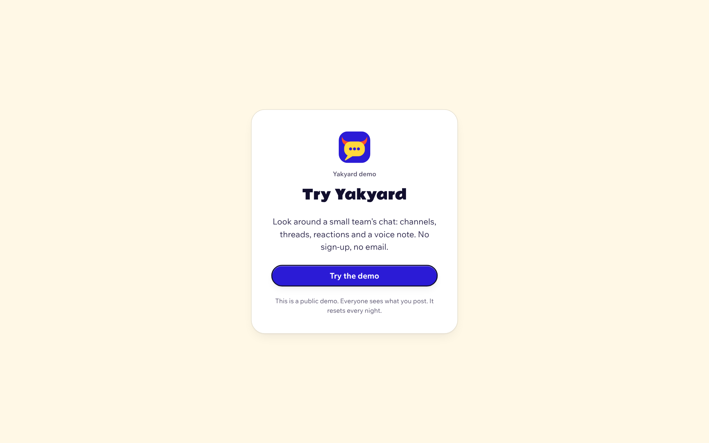
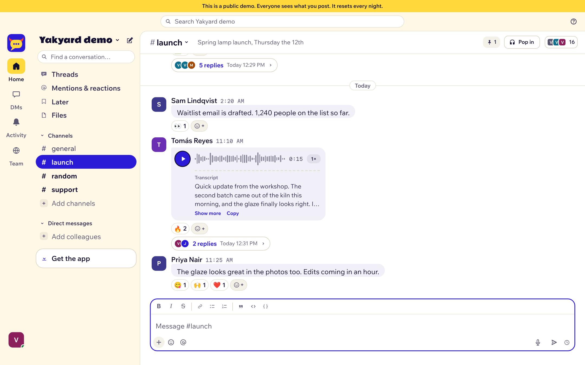

<p align="center"></p>

<h3 align="center">Yakyard is open source now, under Apache 2.0.</h3>
<p align="center">Use it, change it, host it for other people or sell it. And try it first, in a live demo that takes one click.</p>
<p align="center"><a href="https://yakyard-demo.qvinta.workers.dev"><b>Try the live demo</b></a>&nbsp;&nbsp;&nbsp;&nbsp;<a href="#update">Update to 2.1.0</a></p>

## Open source, Apache 2.0

Versions 1.0.0 and 2.0.0 came under PolyForm Shield, which let any business use Yakyard but stopped anyone from selling it. From 2.1.0 the code is under the Apache License 2.0. Run it for your own team, run it for clients, build a product on it. Keep the copyright and license notices and say what you changed. A NOTICE file carries the copyright and the notices for the code Yakyard uses.

Contributions come in under Apache 2.0 too. Add a `Signed-off-by` line to your commits and that's it, no separate agreement to sign.

## Try it before you install it

The live demo is a made-up team that sells lamps, with four channels, a thread or two, reactions and a voice note with its transcript. Click "Try the demo" and you're in as a visitor, with no email and no password. Everyone sees what you post, and it all resets at 03:00 UTC every night.

<p align="center"><a href="https://yakyard.pages.dev/media/yakyard-demo.mp4"></a></p>
<p align="center"><a href="https://yakyard.pages.dev/media/yakyard-demo.mp4">Watch the 80-second tour</a></p>

Some things are off in the demo, each with a short message saying so: file uploads, new voice notes, admin settings, the Slack import, invites, phone notifications and locked conversations. Want your own public demo? `npm run demo:deploy` puts one on a separate Worker with its own database, so your real Yakyard is never touched.

<p align="center"> </p>

## Updates and backups that run by themselves

If you set Yakyard up with the Deploy button, your copy lives in your own GitHub, and GitHub can now look after it:

- Every night it backs up the database into your own Cloudflare file storage. It keeps the last 7 nights, plus one from just before the latest update.
- On Sunday nights it checks for a new release. If there is one, it backs up again, brings the release into your copy, updates the database and deploys.
- If anything fails, it stops there and opens an issue in your copy saying what happened and what to do. GitHub emails you about it.

It stays off until you turn it on: one Cloudflare token, two GitHub secrets and one variable, about 10 minutes. [The steps are in the setup guide](https://github.com/yakyard/yakyard/blob/main/docs/SETUP.md#updates-and-backups-by-themselves).

## Who runs Yakyard

The README and the FAQ now say it plainly. QVINTA Ltd, a Hong Kong company, makes and maintains Yakyard. It started as the in-house chat of a design and wholesale team that left Slack in 2026, and that team still uses it every day.

## Worth knowing

- Locked conversations are labelled as a preview in the README and the docs. The encryption library underneath has been audited. Yakyard's own code around it hasn't been yet, and the label stays until it is.
- The automatic updates only work for copies made with the Deploy button. If you installed from the terminal, keep using `npm run update`.
- Backups count toward your free 10 GB of Cloudflare file storage.
- The database doesn't change in this release.

## Also in this release

The website is easier to find in search: one address per page, a title of its own on every doc, structured data, a dated sitemap and an `llms.txt` file with the plain facts. It also got a brand and accessibility pass, and release pages for every version: [yakyard.pages.dev](https://yakyard.pages.dev).

## Update

```bash
npm run backup
npm run update
```

New to Yakyard? Setup takes about 30 minutes, no coding: [docs/SETUP.md](https://github.com/yakyard/yakyard/blob/main/docs/SETUP.md).

<p align="center"><a href="https://deploy.workers.cloudflare.com/?url=https://github.com/yakyard/yakyard"></a></p>

<p align="center"><b>Yak all you want. Pay nobody.</b></p>
