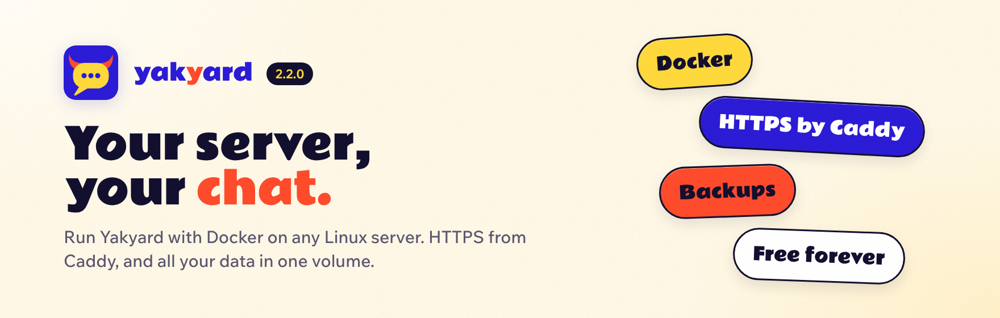
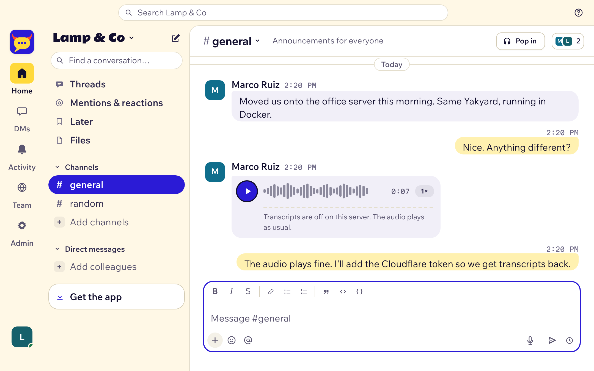

<p align="center"></p>

<h3 align="center">Run Yakyard on your own server now.</h3>
<p align="center">Same app, your hardware. Docker runs it, Caddy handles HTTPS, and every message, file and setting sits in one volume on your disk.</p>
<p align="center"><a href="https://github.com/yakyard/yakyard/blob/main/docs/DOCKER.md"><b>Run it on your own server</b></a>&nbsp;&nbsp;&nbsp;&nbsp;<a href="#update">Update to 2.2.0</a></p>

## Running it with Docker

You need a Linux server with Docker Compose v2, a domain or subdomain pointing at it, and ports 80 and 443 open. 1 GB of memory is enough for a small team. If you've started a `docker compose` app before, it takes about 15 minutes.

```bash
git clone https://github.com/yakyard/yakyard.git
cd yakyard
cp .env.example .env
# set DOMAIN and SETUP_TOKEN in .env
docker compose up -d
```

Make the setup code with `openssl rand -hex 24`. When `docker compose ps` says `healthy`, open `https://your-domain/setup`, paste the code and create the owner account. Caddy gets the HTTPS certificate by itself. [The full guide](https://github.com/yakyard/yakyard/blob/main/docs/DOCKER.md) covers phone notifications, Google sign-in and what to do when something fails.

## What works on your own server

It's the same Yakyard, from the same code. Channels, threads, DMs, calls, search, phone notifications, Google sign-in, the Slack import and locked conversations all work. The Worker runs in workerd, the open-source runtime Cloudflare Workers is built on, through Wrangler's local mode. The database, files and background jobs live in one Docker volume, and the database is brought up to date every time Yakyard starts.

Voice notes record, send and play. Transcripts come from Whisper on Workers AI, which only runs at Cloudflare, so your server calls it over the internet once you set `CF_ACCOUNT_ID` and `CF_API_TOKEN`. A free Cloudflare account is enough. Without them, each voice note says transcripts are off instead of waiting for one that won't come.

<p align="center"></p>

## Backups and updates

One command backs up everything: messages, files, voice notes and settings.

```bash
sh docker/backup.sh
```

It stops Yakyard for a few seconds so the database is copied whole, then saves `backups/yakyard-<date>.tar.gz`. Copy that file off the server. `sh docker/restore.sh` puts a backup back, and asks first. The guide has a cron line that runs the backup every night at 3:00.

Release tags publish the image to `ghcr.io/yakyard/yakyard`. `latest` follows releases. To update only when you choose, pin a version in `.env`, like `YAKYARD_VERSION=2.2.0`. On every change, CI builds the image and runs the full security suite against the container, then restarts it and checks nothing was lost.

## Cloudflare or your own server

| | Cloudflare | Your own server |
|---|---|---|
| Setup | Deploy button or four commands, about 30 minutes | `docker compose up -d`, about 15 minutes |
| Cost | $0 for most teams up to about 50 people | What your server costs |
| Limits | Cloudflare's daily free plan limits | Your server's memory, CPU and disk |
| Transcripts | Built in | Need a free Cloudflare token |
| Scaling | Runs on Cloudflare's network | One server, no failover |
| Upkeep | Cloudflare runs the machines | You: system updates, firewall, disk |

Don't want to look after a server? Stay on Cloudflare. Want your chat on hardware you control, with no daily limits? Use Docker.

## Worth knowing

- Your own server is a newer way to run Yakyard, with fewer teams on it. It runs on Wrangler's local mode, which Cloudflare built for development.
- One server, no automatic scaling and no failover. If the server is down, so is your chat. Size it for your team and keep backups somewhere else.
- You look after the server: operating system updates, the firewall, disk space and Docker.
- Transcripts need a Cloudflare token, and the audio goes to Cloudflare to be transcribed. Voice notes sent while transcripts were off stay without one.
- People in your workspace can read what isn't locked, and so can anyone who gets into the server or its backups.
- Locked conversations are still a preview. The encryption library is audited. Yakyard's own code around it isn't yet.
- `npm run backup` and the automatic updates are for Cloudflare installs. On your own server, use the two scripts.
- There's no guide yet for moving an existing Cloudflare install to your own server.
- The database doesn't change in this release.

## Update

On Cloudflare:

```bash
npm run backup
npm run update
```

On your own server:

```bash
sh docker/backup.sh
git pull
docker compose pull
docker compose up -d
```

New to Yakyard? Setup on Cloudflare takes about 30 minutes, no coding: [docs/SETUP.md](https://github.com/yakyard/yakyard/blob/main/docs/SETUP.md). On your own server: [docs/DOCKER.md](https://github.com/yakyard/yakyard/blob/main/docs/DOCKER.md).

<p align="center"><a href="https://deploy.workers.cloudflare.com/?url=https://github.com/yakyard/yakyard"></a></p>

<p align="center"><b>Yak all you want. Pay nobody.</b></p>
