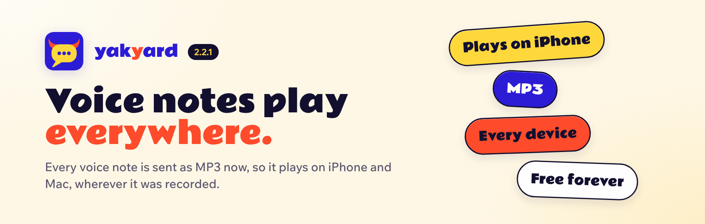
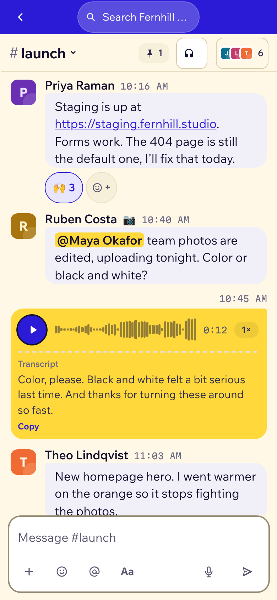

<p align="center"></p>

<h3 align="center">Voice notes now play on iPhone and Mac.</h3>
<p align="center">Every voice note is sent as MP3 now, so it plays on any phone or computer. Plus the fixes from launch testing.</p>
<p align="center"><a href="#update"><b>Update to 2.2.1</b></a>&nbsp;&nbsp;&nbsp;&nbsp;<a href="https://github.com/yakyard/yakyard/blob/main/CHANGELOG.md">Read the changelog</a></p>

## What was wrong

A voice note recorded on Android or in Chrome was saved as WebM or fragmented MP4. Safari on iPhone and Mac can't play those files. So the person on the iPhone saw the note, pressed play and heard nothing.

## What changed

Your phone or computer now turns every voice note into an MP3 before it's sent. MP3 plays in every browser, Safari included. Notes are mono, about 1 MB for 3 minutes, which is plenty for a voice.

If the conversion fails, Yakyard sends the original recording, so your note still goes out. In locked conversations the MP3 is made on your device before anything is encrypted, so locked notes play everywhere too.

<p align="center"></p>

## Also in this release

- Deploy to Cloudflare asks only for `SETUP_TOKEN`. A made-up value in the other secrets broke phone notifications and calls.
- Signing in correctly no longer counts toward the lockout. Only wrong passwords do.
- Docker: `restore.sh` refuses a damaged backup before it touches anything. `backup.sh` can't leave a half backup when the disk is full, and only you can read the backups.
- The Docker guide shows how to try Yakyard on your own computer with `DOMAIN=localhost`, and reminds you to keep a copy of `.env`.
- On phones, Home and DMs have one full-width search box. Search lists matching channels and DMs above messages.
- The live demo opens like a team that's been working for a while, each visitor gets their own DMs, and it lets in up to 300 new visitors every 15 minutes.
- Website and docs: links to headings with an apostrophe work again, and the home page says locked conversations are a preview.

## Worth knowing

- Voice notes sent before 2.2.1 stay as they were. An old note from Android still won't play on an iPhone. Record it again and it will.
- The MP3 is made by the person sending, so their app needs 2.2.1. After you update, each person sees "New version of Yakyard". Tapping Update now is enough.
- The database doesn't change in this release.

## Update

On Cloudflare:

```bash
npm run backup
npm run update
```

On your own server:

```bash
sh docker/backup.sh
git pull
docker compose pull
docker compose up -d
```

If you pinned a version in `.env`, set `YAKYARD_VERSION=2.2.1` first.

New to Yakyard? Setup on Cloudflare takes about 30 minutes, no coding: [docs/SETUP.md](https://github.com/yakyard/yakyard/blob/main/docs/SETUP.md). On your own server: [docs/DOCKER.md](https://github.com/yakyard/yakyard/blob/main/docs/DOCKER.md).

<p align="center"><a href="https://deploy.workers.cloudflare.com/?url=https://github.com/yakyard/yakyard"></a></p>

<p align="center"><b>Yak all you want. Pay nobody.</b></p>
