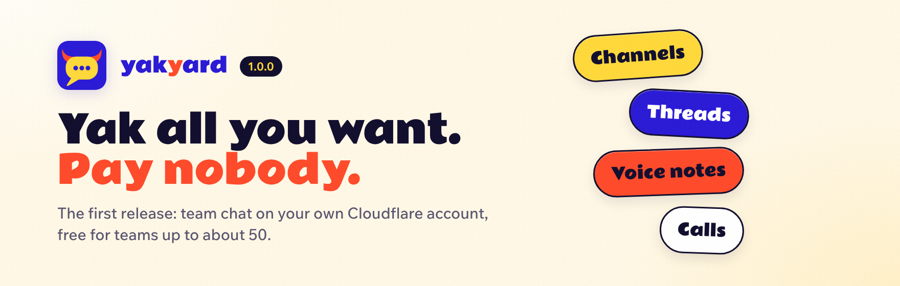
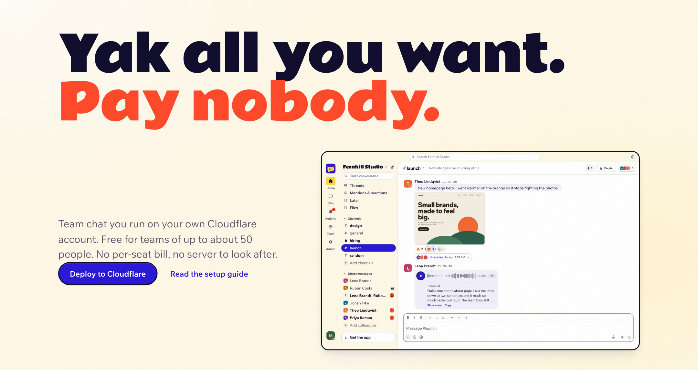
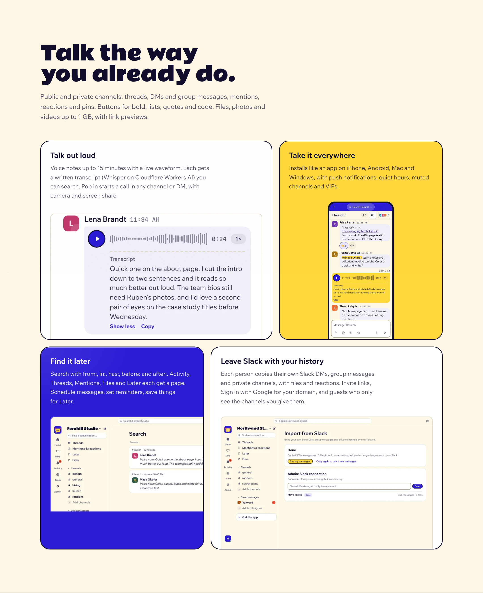
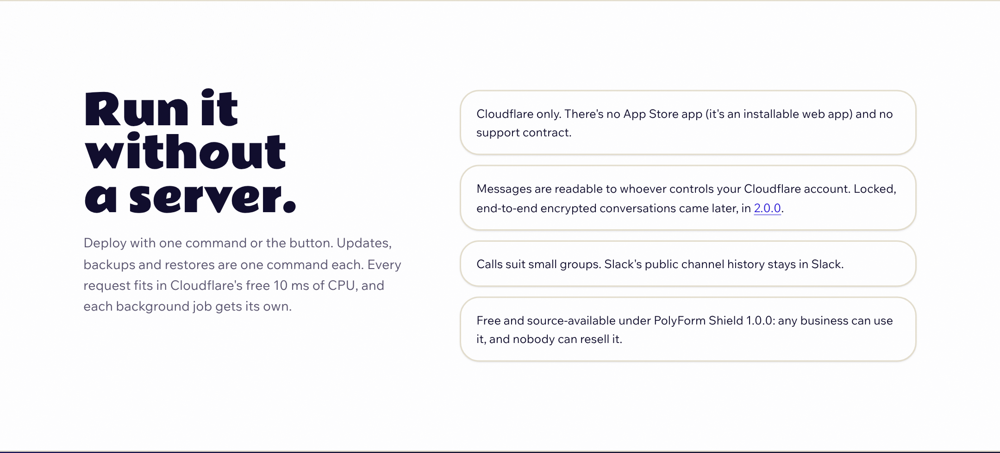

<h3 align="center"><a href="https://yakyard.pages.dev/releases/1.0.0">Read the 1.0.0 release page</a>&nbsp;&nbsp;&nbsp;&nbsp;<a href="https://github.com/yakyard/yakyard/blob/main/docs/SETUP.md">Set it up in about 30 minutes</a></h3>

