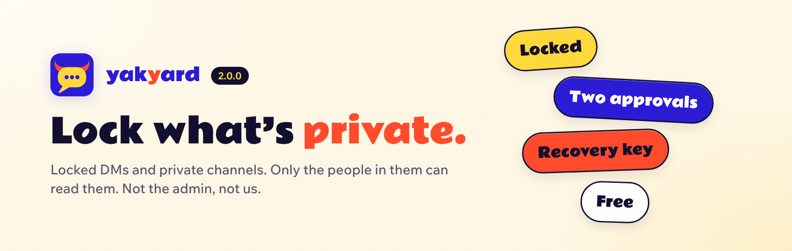
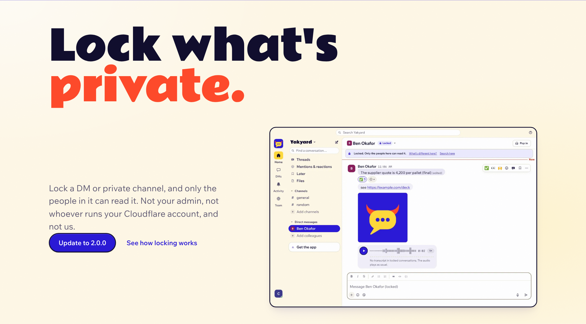
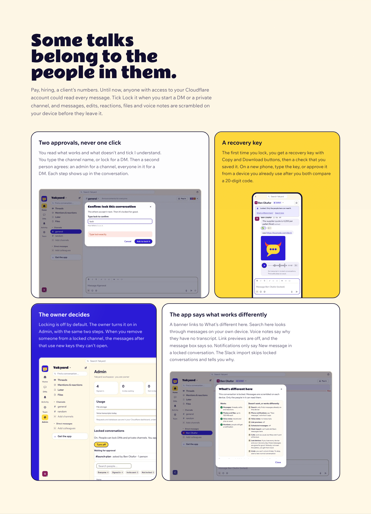
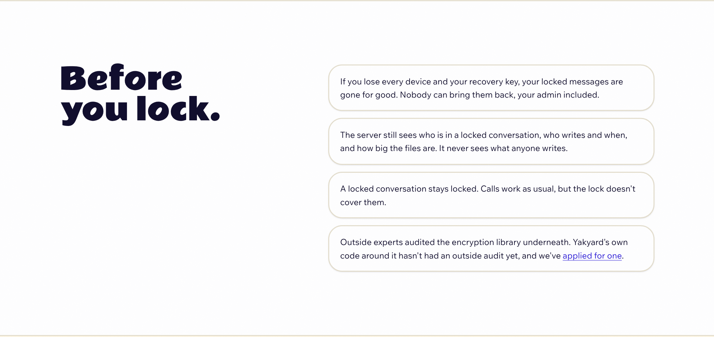
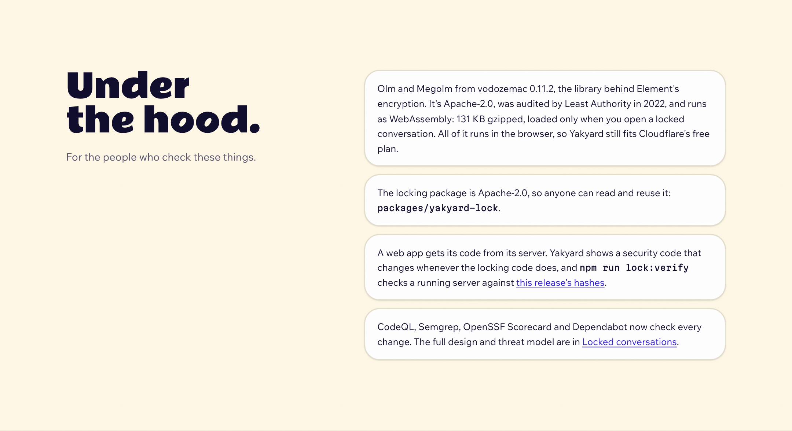
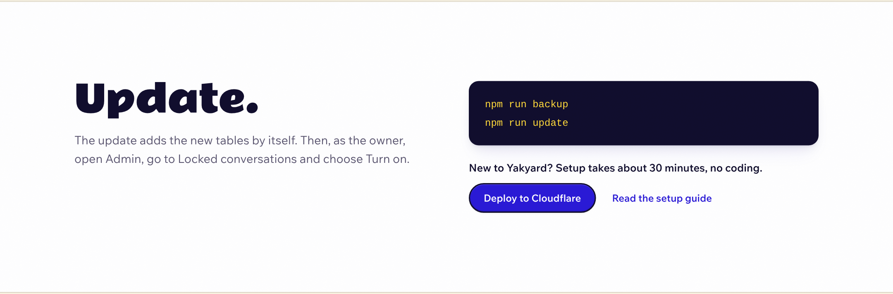

<p align="center"><a href="https://yakyard.pages.dev/releases/2.0.0"></a></p>

<a href="https://yakyard.pages.dev/releases/2.0.0"></a>
<a href="https://yakyard.pages.dev/releases/2.0.0"></a>
<a href="https://yakyard.pages.dev/releases/2.0.0"></a>
<a href="https://yakyard.pages.dev/releases/2.0.0"></a>
<a href="https://yakyard.pages.dev/releases/2.0.0"></a>

<h3 align="center"><a href="https://yakyard.pages.dev/releases/2.0.0">Read the 2.0.0 release page</a>&nbsp;&nbsp;&nbsp;&nbsp;<a href="https://yakyard.pages.dev/docs/locked">How locking works</a></h3>

```bash
npm run backup
npm run update
```

Then, as the owner, open Admin, go to Locked conversations and choose Turn on. Full details and the threat model: [docs/E2EE.md](https://github.com/yakyard/yakyard/blob/main/docs/E2EE.md). Hashes for this release: [docs/E2EE-HASHES.md](https://github.com/yakyard/yakyard/blob/main/docs/E2EE-HASHES.md).

<p align="center"><a href="https://deploy.workers.cloudflare.com/?url=https://github.com/yakyard/yakyard"></a></p>
